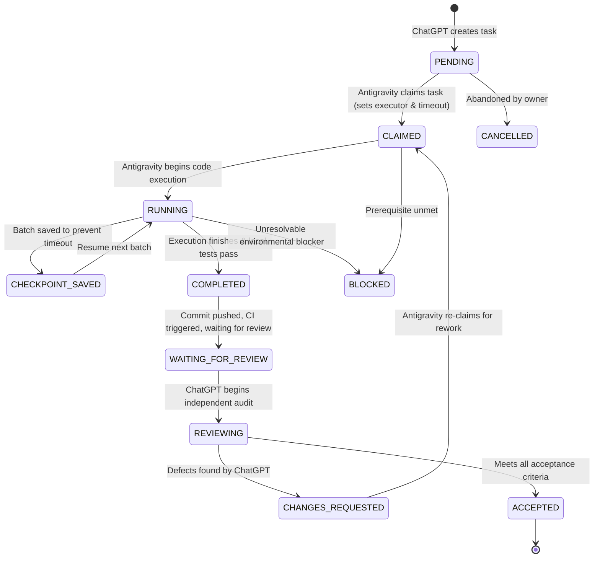

# PROTOCOL SPECIFICATION — ZHONGWENHUB AI COLLABORATION BRIDGE V1

Tài liệu đặc tả quy chuẩn giao thức trao đổi dữ liệu, máy trạng thái (state machine), phân quyền và kiểm soát đồng thời giữa **ChatGPT** và **Antigravity**.

---

## 1. Máy trạng thái Task (Task State Machine)

### 1.1 Quy tắc chuyển trạng thái hợp lệ
1. `PENDING -> CLAIMED`: Executor nhận nhiệm vụ, tăng `revision`, thiết lập hạn claim.
2. `CLAIMED -> RUNNING`: Bắt đầu thực thi các thay đổi mã nguồn.
3. `RUNNING -> CHECKPOINT_SAVED`: Lưu trạng thái trung gian, mã băm các file đã hoàn thành.
4. `CHECKPOINT_SAVED -> RUNNING`: Tái tục xử lý batch tiếp theo mà không làm lại bước cũ.
5. `RUNNING -> COMPLETED`: Hoàn tất mã nguồn và toàn bộ test suite cục bộ đạt yêu cầu.
6. `COMPLETED -> WAITING_FOR_REVIEW`: Kết quả kiểm thử (result) được ghi nhận kèm `commit_sha`.
7. `WAITING_FOR_REVIEW -> REVIEWING`: Reviewer độc lập (ChatGPT) bắt đầu đánh giá diff và CI artifacts.
8. `REVIEWING -> CHANGES_REQUESTED`: Reviewer phát hiện lỗi hoặc thiếu sót, tạo review manifest.
9. `CHANGES_REQUESTED -> CLAIMED`: Executor tiếp nhận các yêu cầu sửa lỗi để chuẩn bị commit mới.
10. `REVIEWING -> ACCEPTED`: Reviewer xác nhận đạt 100% tiêu chí nghiệm thu kỹ thuật.
11. Bất kỳ trạng thái nào trước `ACCEPTED` có thể chuyển sang `BLOCKED` nếu gặp sự cố môi trường không thể vượt qua an toàn.

### 1.2 Các chuyển đổi bị CẤM TUYỆT ĐỐI (Strict Invariants)
- **CẤM `PENDING -> ACCEPTED`**: Không được nghiệm thu task chưa qua thực thi và kiểm thử.
- **CẤM `RUNNING -> ACCEPTED`**: Không được nhảy cóc qua bước kiểm thử độc lập.
- **CẤM Executor tự nghiệm thu**: Antigravity không được phép ký duyệt review `ACCEPTED` cho chính code của mình. Reviewer bắt buộc phải là ChatGPT hoặc QA Lead.
- **CẤM Review commit SHA không khớp**: Không thể dùng kết quả kiểm thử của commit cũ để nghiệm thu commit mới.
- **CẤM Hai Executor cùng claim**: Sử dụng optimistic concurrency check trên trường `revision`.
- **CẤM Ghi đè lịch sử execution**: Mỗi lần hoàn thành tạo một `execution_id` duy nhất và lưu kết quả độc lập.

---

## 2. Kiểm soát đồng thời & Ghi file nguyên tử (Concurrency & Atomic Writes)

1. **Optimistic Locking**:
   - Mọi thực thể `task` đều mang trường số nguyên `revision`.
   - Khi cập nhật trạng thái, CLI bắt buộc phải đối chiếu `revision` hiện tại trên ổ đĩa. Nếu phát hiện `expected_revision != disk_revision`, thao tác bị hủy và báo lỗi `CONCURRENCY_CONFLICT`.
2. **Atomic File Write**:
   - Tất cả các thao tác ghi file JSON protocol đều thực hiện ghi vào file tạm `.tmp.<uuid>`, flush xuống đĩa, sau đó thực hiện lệnh nguyên tử `os.replace` (hoặc move ghi đè) để tránh file bị hỏng khi agent bị crash hoặc timeout.
3. **Phòng chống Replay & Duplicate**:
   - `task_id` tuân thủ định dạng regex `^[A-Z0-9_-]{5,64}$`.
   - `execution_id` sinh ngẫu nhiên dạng `exec_<timestamp>_<uuid4_short>`.

---

## 3. Khôi phục sau sự cố & Timeout (Crash Recovery & Checkpointing)

1. Khi Antigravity gặp sự cố `stream idle timeout (5m0s)` hoặc bị ngắt tiến trình:
   - File checkpoint tại `.ai-collaboration/state/checkpoints/<task_id>.json` lưu lại toàn bộ tiến độ các batch đã hoàn thành kèm mã băm SHA-256 của từng file đầu ra.
   - Khi khởi động lại, lệnh `python scripts/ai_bridge/bridge.py resume <task_id>` đọc checkpoint, xác minh hash của các file đã xử lý và tiếp tục chính xác tại `in_progress_step` mà không chạy lại các batch đã PASS.
