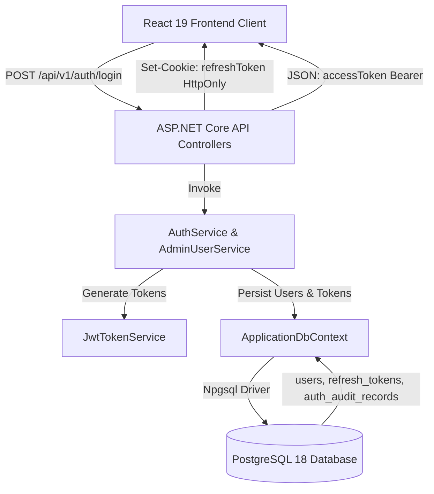

# TÀI LIỆU TRIỂN KHAI BE-2 — AUTHENTICATION, USER MANAGEMENT & RBAC

**Dự án:** ZhongWenHub  
**Phiên bản:** BE-2 (v2.0.0)  
**Tác giả:** ZhongWenHub Senior Engineering Team  
**Ngày hoàn thành:** 29/10/2026  
**Mục tiêu:** Tích hợp xác thực JWT, phân quyền Role-Based Access Control (RBAC) trên 6 vai trò chính thức, API quản lý người dùng với PostgreSQL và kết nối hoàn chỉnh với Frontend React 19 / Bun.

---

## 1. TỔNG QUAN KIẾN TRÚC VÀ CÁC THÀNH PHẦN

Hệ thống BE-2 được xây dựng trên nền tảng Clean Architecture kết hợp ASP.NET Core 8 Web API, Entity Framework Core, PostgreSQL và ASP.NET Core Identity.



### Các lớp kiến trúc chính:
- **ZhongWenHub.Domain**: Thực thể miền (`ApplicationUser`, `ApplicationRole`, `RefreshToken`, `AuthAuditRecord`), Enum (`UserStatus`), Constants (`RoleConstants`, `PolicyConstants`).
- **ZhongWenHub.Application**: Hợp đồng DTOs (`LoginRequestDto`, `UserDto`, `AdminUserListItemDto`, `AdminUserDetailDto`, `AdminUserKpisDto`, `CreateAdminUserDto`, `UpdateAdminUserDto`, `UpdateUserRolesDto`), Abstractions (`IAuthService`, `IAdminUserService`, `IJwtTokenService`, `ICurrentUserService`).
- **ZhongWenHub.Infrastructure**: Cấu hình EF Core DbContext, ASP.NET Core Identity, JWT Bearer configuration, Service implementations (`AuthService`, `AdminUserService`, `JwtTokenService`, `CurrentUserService`), Database Migrations (`20261029220000_AddUserLockFields`).
- **ZhongWenHub.Api**: REST Controllers (`AuthController`, `AdminUsersController`, `SystemController`), Middlewares (`ProblemDetailsMiddleware`, `SecurityHeadersMiddleware`).

---

## 2. HỆ THỐNG PHÂN QUYỀN RBAC VÀ 6 VAI TRÒ CHÍNH THỨC

Hệ thống quản lý 6 vai trò chính thức:
1. `SUPER_ADMIN`: Quản trị viên tối cao, toàn quyền hệ thống, quản lý tài khoản quản trị viên và cấu hình.
2. `ADMIN`: Quản trị viên vận hành hệ thống, quản lý người dùng (ngoại trừ Super Admin), xem báo cáo và dashboard.
3. `CONTENT_MANAGER`: Quản lý kho nội dung, video, từ vựng HSK, ngữ pháp, bài tập và xử lý lỗi học liệu.
4. `TEACHER`: Quản lý lớp học, bài tập phân công và xem kết quả học viên của lớp.
5. `SUPPORT`: Nhân viên chăm sóc khách hàng, xử lý vé hỗ trợ (tickets) và chuyển tiếp lỗi nội dung.
6. `STUDENT`: Học viên học tiếng Trung, làm bài tập, xem tiến độ học tập và quản lý hồ sơ cá nhân.

### Danh mục Authorization Policies (ASP.NET Core Policy-Based):
- `UserManagementAccess`: Yêu cầu vai trò `SUPER_ADMIN` hoặc `ADMIN`.
- `SystemSettingsManage`: Yêu cầu vai trò `SUPER_ADMIN`.
- `AdminAccess`: Yêu cầu vai trò `SUPER_ADMIN` hoặc `ADMIN`.
- `ContentManagementAccess`: Yêu cầu vai trò `SUPER_ADMIN`, `ADMIN` hoặc `CONTENT_MANAGER`.
- `TeacherAccess`: Yêu cầu vai trò `SUPER_ADMIN`, `ADMIN` hoặc `TEACHER`.
- `SupportAccess`: Yêu cầu vai trò `SUPER_ADMIN`, `ADMIN` hoặc `SUPPORT`.
- `StudentAccess`: Yêu cầu một trong 6 vai trò đã xác thực.

---

## 3. CƠ CHẾ BẢO MẬT VÀ PHÒNG CHỐNG LỖ HỔNG

1. **Không lưu trữ Refresh Token thô:** Refresh Token trước khi ghi xuống PostgreSQL được băm bằng SHA-256 (`TokenHash`). Token thô chỉ được trả về một lần duy nhất qua HttpOnly Cookie.
2. **HttpOnly, Secure, SameSite Cookie:** Refresh Token được lưu trong cookie với cờ `HttpOnly = true`, `SameSite = Lax` (hoặc `Strict`), `Path = /api/v1/auth`. JavaScript client hoàn toàn không thể đọc được token từ DOM hay localStorage, loại bỏ triệt để nguy cơ đánh cắp token qua XSS.
3. **Phát hiện và ngăn chặn Tấn công Sử dụng lại Token (Refresh Token Reuse Attack):** Khi phát hiện một Refresh Token đã bị thu hồi (`IsRevoked == true`) được gửi lên, hệ thống kích hoạt cơ chế thu hồi khẩn cấp toàn bộ các token đang hoạt động của người dùng đó và ghi audit log cảnh báo.
4. **Chống Leo quyền (Privilege Escalation):**
   - Admin thường **không thể** tự nâng quyền hoặc gán quyền `SUPER_ADMIN` cho bất kỳ ai (trả về HTTP 403 Forbidden).
   - Admin thường **không thể** chỉnh sửa, vô hiệu hóa hoặc khóa tài khoản `SUPER_ADMIN` (trả về HTTP 403 Forbidden).
   - Người dùng thường **không thể** tự thay đổi vai trò của mình qua API cập nhật hồ sơ (trả về HTTP 403 Forbidden).
   - Hệ thống **bảo vệ Super Admin cuối cùng**: Không cho phép xóa, khóa hoặc tước quyền Super Admin đang hoạt động duy nhất.
5. **Audit Logging toàn diện:** Mọi hành vi đăng nhập, đăng xuất, khóa, mở khóa, thay đổi vai trò, và các lần cố gắng leo quyền đều được ghi lại vào bảng `auth_audit_records`.

---

## 4. HƯỚNG DẪN KHỞI CHẠY VÀ KIỂM THỬ

### Backend:
1. Đảm bảo PostgreSQL 18 đang chạy tại `127.0.0.1:5432` với database `zhongwenhub_dev`.
2. Chạy ứng dụng Backend:
   ```powershell
   $env:DOTNET_ROOT = 'C:\Users\nguyen\AppData\Local\dotnet'
   & "d:\ZhongWenHub\Backend\publish\ZhongWenHub.Api.exe" --urls "http://127.0.0.1:5000"
   ```
   Ứng dụng sẽ tự động áp dụng các migration và khởi tạo dữ liệu mẫu nếu chưa có.

### Frontend:
1. Di chuyển vào thư mục `Fontend`:
   ```bash
   cd Fontend
   bun install
   bun run dev
   ```
2. Truy cập ứng dụng tại `http://localhost:5173/ZhongWenHub/`.
3. Kiểm thử với các tài khoản:
   - Học viên: `student@example.com` / `ExamplePassword123!` -> Điều hướng vào Student Portal (`/dashboard`).
   - Quản trị viên: `admin@zhongwenhub.edu.vn` / `AdminPassword123!` -> Điều hướng vào Admin Portal (`/management/admin/dashboard`).
   - Super Admin: `superadmin@zhongwenhub.edu.vn` / `SuperAdmin123!` -> Toàn quyền hệ thống.
