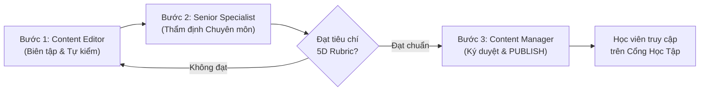

# HÀNG ĐỢI KIỂM DUYỆT CHẤT LƯỢNG NỘI DUNG HSK 3.0
## Editorial Quality Assurance Rubric, Review Workflow & Lesson Approval Queue
**Dự án**: ZhongWenHub — Hệ thống Đào tạo & Quản trị Học liệu Tiếng Trung Chuẩn Quốc tế  
**Giai đoạn**: Phase 3 — Quản lý Chất lượng Nội dung & Hàng đợi Kiểm duyệt  
**Căn cứ quy chuẩn**: Tiêu chuẩn Khảo thí CTI/CLEC & CSDL `ZhongWenHub_Dev`  
**Ngày ban hành**: 08/11/2026  
**Chuyên gia phụ trách**: Senior Pedagogical Quality Specialist & Editorial Board  

---

## 1. TỔNG QUAN PHÂN LOẠI TRẠNG THÁI KIỂM DUYỆT 140 BÀI HỌC

Toàn bộ 140 bài học của hệ thống giáo trình HSK 3.0 hiện được phân loại minh bạch thành 2 nhóm trạng thái:

```
TỔNG SỐ 140 BÀI HỌC GIÁO TRÌNH HSK 3.0
├── 1. VERIFIED_PUBLISHED (Đã thẩm định & Xuất bản chính thức): 3 bài học (2.1%)
│   ├── HSK 1 - Lesson 1: 你好 (Chào bạn)
│   ├── HSK 1 - Lesson 2: 谢谢你 (Cảm ơn bạn)
│   └── HSK 1 - Lesson 3: 你叫什么名字 (Bạn tên là gì)
│       └── Học sinh trên toàn hệ thống đang học tập bình thường.
│
└── 2. PENDING_EDITORIAL_REVIEW (Đang trong Hàng đợi Kiểm duyệt Chuyên môn): 137 bài học (97.9%)
    ├── Đợt 1 (Ưu tiên Cao): HSK 1 (12 bài: L4 đến L15)
    ├── Đợt 2 (Ưu tiên Cao): HSK 2 (15 bài: L1 đến L15)
    ├── Đợt 3 (Ưu tiên Trung bình): HSK 3 (20 bài: L1 đến L20)
    ├── Đợt 4 (Ưu tiên Trung bình): HSK 4 (20 bài: L1 đến L20)
    ├── Đợt 5 (Ưu tiên Tiêu chuẩn): HSK 5 (30 bài: L1 đến L30)
    └── Đợt 6 (Ưu tiên Tiêu chuẩn): HSK 6 (40 bài: L1 đến L40)
        └── Giữ trạng thái DRAFT trong SQL Server; không hiển thị trên Cổng Học Viên.
```

---

## 2. BỘ TIÊU CHÍ THẨM ĐỊNH CHẤT LƯỢNG NỘI DUNG 5 CHIỀU (5D EDITORIAL RUBRIC)

Để được phê duyệt chuyển từ `DRAFT / PENDING_REVIEW` sang `PUBLISHED`, mỗi bài học phải vượt qua đánh giá 5 chiều:

```
┌────────────────────────────────────────────────────────────────────────────────────────┐
│ CHIỀU 1: CHUẨN XÁC NGỮ ÂM & PHIÊN ÂM PINYIN (Phonetic & Tone Accuracy)                 │
│ - 100% thanh điệu chuẩn quốc tế Unicode (ví dụ: ā, á, ǎ, à; không dùng số 1, 2, 3, 4). │
│ - Quy tắc biến điệu: Biến điệu của 不 (bù/bú), 一 (yī/yí/yì), biến điệu hai thanh 3.    │
│ - Quy tắc viết hoa tên riêng (người, địa danh): Dàwèi, Běijīng, Zhōngguó.              │
└────────────────────────────────────────┬───────────────────────────────────────────────┘
                                         │
┌────────────────────────────────────────▼───────────────────────────────────────────────┐
│ CHIỀU 2: TỪ VỰNG & CHỐNG VƯỢT CẤP (Vocabulary Appropriateness & Anti-Leakage)          │
│ - Tối thiểu 80% từ vựng trong bài khóa phải nằm trong danh mục từ của bài học đó.      │
│ - 20% từ vựng còn lại chỉ được lấy từ các bài học cấp thấp hơn đã học trước đó.        │
│ - Tuyệt đối không xuất hiện từ vựng thuộc cấp HSK cao hơn mà không có chú thích nghĩa.│
└────────────────────────────────────────┬───────────────────────────────────────────────┘
                                         │
┌────────────────────────────────────────▼───────────────────────────────────────────────┐
│ CHIỀU 3: NGỮ PHÁP & CẤU TRÚC CÂU (Grammatical Rigor & Formula Adherence)               │
│ - Lời thoại và bài đọc phải làm nổi bật ít nhất 1–2 cấu trúc ngữ pháp trọng tâm bài. │
│ - Đảm bảo trật tự từ chuẩn ngữ pháp tiếng Hán (Trạng ngữ thời gian/nơi chốn trước V).│
│ - Không diễn đạt kiểu "dịch word-by-word" từ tiếng Việt hay tiếng Anh (Chinglish).     │
└────────────────────────────────────────┬───────────────────────────────────────────────┘
                                         │
┌────────────────────────────────────────▼───────────────────────────────────────────────┐
│ CHIỀU 4: TÍNH TỰ NHIÊN CỦA BÀI KHÓA (Situational Authenticity & Pragmatics)            │
│ - Ngữ cảnh giao tiếp thực tế, sinh động (nhà hàng, sân bay, công sở, phòng khám...).   │
│ - HSK 1–3: Ngôn ngữ khẩu ngữ tự nhiên, gần gũi, giàu trợ từ ngữ khí (吧, 呢, 啊).     │
│ - HSK 4–6: Chuyển dịch dần sang văn phong thư diện ngữ (书面语), trang trọng, học thuật│
└────────────────────────────────────────┬───────────────────────────────────────────────┘
                                         │
┌────────────────────────────────────────▼───────────────────────────────────────────────┐
│ CHIỀU 5: THIẾT KẾ CÂU HỎI & GIẢI THÍCH SƯ PHẠM (Pedagogical Assessment & Clarity)      │
│ - Câu hỏi trắc nghiệm kiểm tra đúng trọng tâm bài khóa và điểm ngữ pháp bài học.       │
│ - Các phương án nhiễu (distractors) có tính thuyết phục, không đánh đố phi lý.        │
│ - Lời giải thích rõ ràng, chỉ rõ căn cứ chọn đáp án đúng dựa trên bài khóa.            │
└────────────────────────────────────────────────────────────────────────────────────────┘
```

---

## 3. QUY TRÌNH PHÊ DUYỆT 3 CẤP TRÊN CMS QUẢN TRỊ (WORKFLOW)



1. **Bước 1 — Biên tập & Rà soát văn bản (Content Editor)**:
   - Sử dụng giao diện `LessonEditor` trên CMS để kiểm tra từng câu thoại, sửa lỗi chính tả, căn chỉnh bản dịch nghĩa tiếng Việt.
   - Gắn cờ trạng thái: `SUBMITTED_FOR_REVIEW`.
2. **Bước 2 — Thẩm định chuyên môn (Senior Pedagogical Specialist)**:
   - Đọc đối chiếu bài học với Rubric 5 chiều.
   - Ghi chú nhận xét (Feedback Notes) trực tiếp trên từng mục nếu cần sửa đổi.
   - Ký xác nhận thẩm định: `EDITORIAL_APPROVED`.
3. **Bước 3 — Xuất bản chính thức (Content Manager / Admin)**:
   - Nhấn nút **"Phê duyệt & Xuất bản" (`PUBLISH LESSON`)**.
   - Hệ thống thực hiện cập nhật nguyên tử: Chuyển trạng thái bài học thành `PUBLISHED` và đồng bộ xuất bản danh mục từ vựng, điểm ngữ pháp liên kết, mở khóa nội dung cho học viên.

---

## 4. DANH MỤC HÀNG ĐỢI KIỂM DUYỆT ƯU TIÊN THEO ĐỢT (EDITORIAL BATCHES)

### Đợt 1: HSK Cấp 1 (Hoàn thiện xuất bản toàn cấp) — 12 bài học
| STT | Bài học (Lesson) | Tiêu đề tiếng Trung & tiếng Việt | Nhiệm vụ kiểm duyệt trọng tâm | Mức ưu tiên |
|:---:|---|---|---|:---:|
| 1 | L4 | 他是我的汉语老师 (Thầy ấy là giáo viên tiếng Trung của tôi) | Kiểm tra trợ từ 的 và phân biệt 他/她. | **CAO NHẤT** |
| 2 | L5 | 我想喝茶 (Tôi muốn uống trà) | Kiểm tra động từ năng nguyện 想 và đơn vị tiền tệ 块. | **CAO NHẤT** |
| 3 | L6 | 你在做什么呢 (Bạn đang làm gì thế) | Kiểm tra phó từ 在/正在 và trợ từ 呢. | **CAO NHẤT** |
| 4 | L7 | 今天星期几 (Hôm nay là thứ mấy) | Kiểm tra trật tự thời gian (Năm - Tháng - Ngày - Thứ). | **CAO** |
| 5 | L8 | 明天天气怎么样 (Thời tiết ngày mai thế nào) | Kiểm tra phó từ 太...了 và từ chỉ thời tiết. | **CAO** |
| 6 | L9 | 现在几点 (Bây giờ là mấy giờ) | Kiểm tra cách nói giờ, phút, rưỡi (半). | **CAO** |
| 7 | L10 | 我星期一去北京 (Thứ hai tôi đi Bắc Kinh) | Kiểm tra thời gian làm trạng ngữ trước động từ. | **CAO** |
| 8 | L11 | 这个苹果多少钱 (Quả táo này bao nhiêu tiền) | Kiểm tra hỏi giá 多少 tiền và mặc cả đơn giản. | **CAO** |
| 9 | L12 | 你去哪儿买东西 (Bạn đi đâu mua đồ) | Kiểm tra giới từ 在 chỉ nơi chốn và động từ 去. | **CAO** |
| 10 | L13 | 他在学校前面 (Anh ấy ở phía trước trường học) | Kiểm tra từ chỉ phương vị (上, 下, 前, 后). | **CAO** |
| 11 | L14 | 你会开车吗 (Bạn biết lái xe không) | Kiểm tra động từ năng nguyện 会 chỉ kỹ năng. | **CAO** |
| 12 | L15 | 我是坐飞机来的 (Tôi đến bằng máy bay) | Kiểm tra cấu trúc nhấn mạnh 是...的 và tổng ôn tập. | **CAO** |

---

### Đợt 2: HSK Cấp 2 (Mở rộng sinh hoạt & đời sống) — 15 bài học
- Bao gồm 15 bài học từ L1 (`九月去北京旅游最好`) đến L15 (`新年就要到了`).
- Trọng tâm kiểm duyệt: Cấu trúc so sánh 比, câu chữ 就, trợ từ động thái 了 (biến đổi), trợ từ 着 (tiếp diễn trạng thái), trợ từ 过 (kinh nghiệm từng trải).
- Mức độ ưu tiên: **CAO** (kế hoạch hoàn thành kiểm duyệt sau Đợt 1).

---

### Đợt 3 & 4: HSK Cấp 3 & HSK Cấp 4 — 40 bài học
- HSK 3 (20 bài): Thẩm định câu chữ 把 (把字句), bổ ngữ xu hướng kép (V + 出来/起来/下去), câu so sánh 跟...一样.
- HSK 4 (20 bài): Thẩm định câu bị động (被字句), cấu trúc phản vấn 连...都/也..., từ ngữ chuyển ý thư diện ngữ.
- Mức độ ưu tiên: **TRUNG BÌNH**.

---

### Đợt 5 & 6: HSK Cấp 5 & HSK Cấp 6 — 70 bài học
- HSK 5 (30 bài): Thẩm định phong cách viết luận, hư từ cổ ngữ thông dụng (乃, 亦, 尚), báo cáo phân tích kinh tế - xã hội.
- HSK 6 (40 bài): Thẩm định thành ngữ 4 chữ (成语), tu từ cổ điển, văn kiện ngoại giao và nghiên cứu học thuật.
- Mức độ ưu tiên: **TIÊU CHUẨN**.
