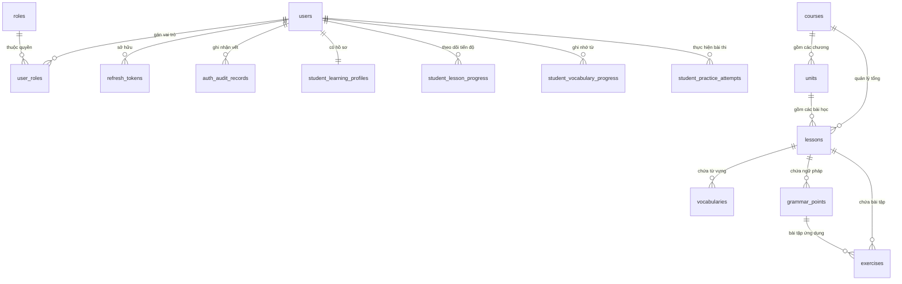

# BÁO CÁO TÌM HIỂU SOURCE CODE VÀ HƯỚNG DẪN VẬN HÀNH DỰ ÁN ZHONGWENHUB
**Hệ thống học tiếng Trung trực tuyến thông minh (ZhongWenHub)**  
*Tài liệu nội bộ dành cho sinh viên chuẩn bị báo cáo tiến độ đồ án tốt nghiệp*

---

> [!NOTE]
> **Mục tiêu của tài liệu:** Cung cấp bức tranh toàn cảnh, thực tế và chuẩn xác 100% theo source code hiện có tại kho lưu trữ `D:\ZhongWenHub`. Đọc xong tài liệu này, bạn sẽ nắm vững cấu trúc thư mục, luồng dữ liệu từ giao diện React xuống database SQL Server, vị trí các file quan trọng, cách tự chạy/gỡ lỗi dự án và tự tin trả lời 15 câu hỏi phản biện của Hội đồng giảng viên.

---

## MỤC LỤC TỔNG QUAN

1. [Phần 1: Cấu trúc thư mục dự án thực tế](#phần-1-cấu-trúc-thư-mục-dự-án-thực-tế)
   - 1.1 Tổng quan kiến trúc Monorepo hai nhánh
   - 1.2 Thư mục Frontend (`Fontend/`)
   - 1.3 Thư mục Backend (`Backend/`)
   - 1.4 Các file cấu hình hệ thống cốt lõi
2. [Phần 2: 20 file quan trọng nhất định phải biết](#phần-2-20-file-quan-trọng-nhất-định-phải-biết)
3. [Phần 3: Cơ chế vận hành & Luồng dữ liệu End-to-End](#phần-3-cơ-chế-vận-hành--luồng-dữ-liệu-end-to-end)
   - 3.1 Mô hình 5 lớp chuẩn
   - 3.2 Ví dụ 1: Người dùng đăng nhập hệ thống (Authentication & JWT)
   - 3.3 Ví dụ 2: Admin thêm mới hoặc chỉnh sửa tài khoản người dùng
   - 3.4 Ví dụ 3: Quản lý học liệu HSK (Thêm mới & Import CSV/Excel từ vựng)
4. [Phần 4: Cơ sở dữ liệu SQL Server (`ZhongWenHub_Dev`)](#phần-4-cơ-sở-dữ-liệu-sql-server-zhongwenhub_dev)
   - 4.1 Danh sách bảng và chức năng phân nhóm
   - 4.2 Khóa chính (PK), Khóa ngoại (FK) & Quan hệ ràng buộc
   - 4.3 Sơ đồ thực thể ERD trực quan
   - 4.4 Bảng đối chiếu: Chức năng — Backend File — Bảng SQL Server
5. [Phần 5: Hướng dẫn vận hành, gỡ lỗi & Bộ 15 câu hỏi phản biện](#phần-5-hướng-dẫn-vận-hành-gỡ-lỗi--bộ-15-câu-hỏi-phản-biện)
   - 5.1 Hướng dẫn khởi chạy dự án thực tế
   - 5.2 Hướng dẫn kiểm tra dữ liệu bằng SSMS
   - 5.3 Phương pháp dò lỗi (Debug workflow)
   - 5.4 Bộ 15 câu hỏi giảng viên thường hỏi và gợi ý trả lời xuất sắc

---

## PHẦN 1: CẤU TRÚC THƯ MỤC DỰ ÁN THỰC TẾ

Dự án ZhongWenHub được tổ chức theo mô hình phân tách độc lập Frontend (Single Page Application - React) và Backend (RESTful Web API - ASP.NET Core).

```
D:\ZhongWenHub
├── .github/                 # CI/CD Workflows (GitHub Actions)
├── Backend/                 # Mã nguồn Backend ASP.NET Core (.NET 8/9)
│   ├── docs/                # Tài liệu kỹ thuật, kiến trúc Backend
│   ├── src/                 # Các tầng mã nguồn chính (Clean Architecture)
│   │   ├── Api/             # Tầng Web API (Controllers, Middlewares, Program.cs)
│   │   ├── Business/        # Tầng Nghiệp vụ (Services, DTOs, Business Rules)
│   │   └── Data/            # Tầng Dữ liệu & EF Core (Entities, DbContext, Migrations)
│   ├── tests/               # Unit Tests & Integration Tests
│   └── ZhongWenHub.sln      # Solution file mở bằng Visual Studio
├── Fontend/                 # Mã nguồn Frontend (React 19 + TypeScript + Vite)
│   ├── docs/                # Tài liệu giao diện, checklist tính năng
│   ├── e2e/                 # Kịch bản kiểm thử tự động Playwright E2E
│   ├── public/              # Tài nguyên tĩnh (favicon, logo, icons)
│   ├── src/                 # Toàn bộ mã nguồn TypeScript/TSX của UI
│   ├── bun.lock             # Lockfile quản lý package của Bun runtime
│   ├── package.json         # Danh sách thư viện phụ thuộc và scripts npm
│   └── vite.config.ts       # Cấu hình máy chủ Vite & Reverse Proxy
├── docs/                    # Tài liệu đồ án chung và phân tích hệ thống
└── hsk-1.csv                # File dữ liệu mẫu từ vựng HSK 1 dùng để test import
```

> [!IMPORTANT]
> **Lưu ý đặc biệt về tên thư mục:** Thư mục Frontend trên ổ cứng được đặt tên là `Fontend` (không có chữ `r`). Khi gõ lệnh trên terminal hoặc viết tài liệu, bạn cần chú ý gõ chính xác `cd Fontend`.

---

### 1.1 Chi tiết thư mục `Fontend/` (Giao diện React)

Frontend của ZhongWenHub áp dụng cấu trúc **Feature-Driven Architecture** (chia theo từng tính năng nghiệp vụ), giúp dự án không bị lộn xộn khi phình to.

| Thư mục / File con | Chức năng & Vai trò | Loại file chứa bên trong | Khi nào cần mở / sửa? |
|---|---|---|---|
| `Fontend/src/main.tsx` | Điểm vào khởi chạy (Entry point) của ứng dụng React, gắn component `App` vào thẻ DOM `<div id="root">`. | TypeScript JSX (`.tsx`) | Khi muốn đổi Theme Provider toàn cục hoặc sửa cấu hình ReactDOM StrictMode. |
| `Fontend/src/app/` | Cấu hình trung tâm của ứng dụng: Router chính (`AppRouter.tsx`), danh sách tuyến đường (`auth.routes.tsx`, `management.routes.tsx`, `student.routes.tsx`), Providers bọc ngoài (`AppProviders.tsx`). | `.tsx`, `.ts` | Khi muốn thêm một trang mới, phân nhánh đường dẫn URL hoặc bọc thêm Context toàn cục. |
| `Fontend/src/core/` | Tầng hạ tầng dùng chung: HTTP Client chuẩn (`http-client.ts`), quản lý Token (`auth-token.service.ts`), xử lý lỗi API (`api-error.ts`). | TypeScript thuần (`.ts`) | Khi muốn sửa logic tự động gắn JWT Bearer Header, cấu hình Base URL hoặc xử lý refresh token tự động. |
| `Fontend/src/features/` | Chứa các module nghiệp vụ của Học viên (Student): `auth`, `dashboard`, `learning-path`, `lesson`, `vocabulary`, `practice`, `grammar`, `ai-tutor`, v.v. | Mỗi feature gồm `components/`, `pages/`, `services/`, `types/` | Khi muốn sửa logic hoặc giao diện chức năng của phía Học viên (ví dụ: giao diện học từ vựng, flashcard, làm bài tập). |
| `Fontend/src/management/` | Phân hệ quản trị nâng cao dành cho các vai trò: `admin`, `content-manager`, `teacher`, `support`, và các component dùng chung (`shared/`). | Các trang Dashboard, bảng biểu CRUD, bộ lọc dữ liệu | Khi muốn sửa màn hình Quản lý người dùng của Admin, màn hình duyệt khóa học hay quản trị ngân hàng đề thi. |
| `Fontend/src/design-system/`| Thư viện UI UI/UX cơ sở của dự án (Button, Input, Modal, Badge, Typography,...). | `.tsx`, `.css` | Khi muốn đồng bộ màu sắc, quy chuẩn thiết kế, style giao diện trên toàn hệ thống. |
| `Fontend/src/layouts/` | Các layout khung sườn: `StudentLayout` (có thanh menu học tập), `ManagementLayout` (sidebar quản trị), `AuthLayout` (khung đăng nhập). | `.tsx`, `.css` | Khi muốn đổi thanh menu bên trái (Sidebar), thanh tiêu đề trên cùng (Header) hoặc Footer. |
| `Fontend/src/hooks/` & `services/` | Các Custom Hooks và Services API chung ở mức toàn cục. | `.ts` | Khi muốn tái sử dụng một hàm tiện ích hoặc logic state giữa nhiều màn hình. |

> [!NOTE]
> **Giải đáp thắc mắc về `components/`, `pages/`, `routes/`:**  
> Trong dự án ZhongWenHub, lập trình viên không gom toàn bộ page vào một thư mục `src/pages` khổng lồ, mà **chia nhỏ theo từng module**:
> - Muốn tìm trang đăng nhập: vào `Fontend/src/features/auth/pages/LoginPage.tsx`.
> - Muốn tìm trang Admin quản lý user: vào `Fontend/src/management/admin/users/pages/AdminUsersPage.tsx`.
> - Muốn xem file định tuyến URL: vào `Fontend/src/app/router/`.

---

### 1.2 Chi tiết thư mục `Backend/` (API ASP.NET Core)

Backend được xây dựng theo kiến trúc nhiều tầng (**Clean Architecture / N-Tier Architecture**), đảm bảo tách biệt độc lập giữa Tầng nhận Request, Tầng Nghiệp vụ và Tầng Dữ liệu.

```
Backend/src/
├── Api/               # Tầng Web API (Giao tiếp HTTP bên ngoài)
│   ├── Controllers/   # Tiếp nhận Request từ Frontend, trả kết quả JSON
│   ├── Middleware/    # Bắt lỗi toàn cục (Exception Middleware), Rate Limit
│   ├── Program.cs     # File gốc cấu hình Dependency Injection, Pipeline
│   └── appsettings.json # Chuỗi kết nối DB, bí mật mã hóa JWT
├── Business/          # Tầng Logic nghiệp vụ (Không phụ thuộc vào Controller)
│   ├── Authentication/# Xử lý đăng nhập, cấp phát JWT, xác minh mật khẩu
│   ├── Users/         # Quản lý tài khoản, phân quyền, khóa mở user
│   ├── Content/       # Quản lý khóa học HSK, từ vựng, ngữ pháp, import file
│   ├── Learning/      # Quản lý tiến độ học tập, ghi nhận XP, lịch sử làm bài
│   ├── Common/        # Các DTOs dùng chung, giao diện IDateTimeProvider
│   └── Authorization/ # Định nghĩa các Policy truy cập (AdminAccess, TeacherAccess,...)
└── Data/              # Tầng Cơ sở dữ liệu & Entity Framework Core
    ├── Entities/      # Định nghĩa các Class đại diện cho các bảng trong SQL
    ├── Persistence/   # ApplicationDbContext, DbInitializer (Seed data)
    └── Constants/     # Tên Role hệ thống (ADMIN, STUDENT,...), tên Policy
```

> [!WARNING]
> **Điểm cần lưu ý về thư mục `Domain`:** Trong cấu trúc thư mục thực tế, dự án **không** tạo một project riêng tên là `Domain`. Thay vào đó, toàn bộ Thực thể (Entities: `ApplicationUser`, `VocabularyEntity`, `CourseEntity`,...) được đặt tập trung trong project `Backend/src/Data/Entities/`. Đây là thiết kế gom cụm thực tế để tối ưu việc ánh xạ trực tiếp sang Entity Framework Core DbContext.

- **Khi muốn thêm một API mới:** Tạo hàm trong Controller (`Backend/src/Api/Controllers/`).
- **Khi muốn sửa công thức tính điểm / validate mật khẩu:** Sửa trong Service (`Backend/src/Business/`).
- **Khi muốn thêm cột dữ liệu mới trong cơ sở dữ liệu:** Sửa file Entity (`Backend/src/Data/Entities/`) và tạo Migration.

---

### 1.3 Các file cấu hình quan trọng nhất

1. **`Backend/src/Api/Program.cs`**:
   - Trái tim khởi động của toàn bộ Backend.
   - Nơi đăng ký dịch vụ (`builder.Services.AddData()`, `builder.Services.AddBusiness()`), cấu hình CORS cho phép cổng `http://localhost:5173` gọi vào, thiết lập Swagger UI và chuỗi Middleware pipeline (`UseAuthentication()`, `UseAuthorization()`).
2. **`Backend/src/Api/appsettings.json`**:
   - Lưu trữ chuỗi kết nối SQL Server: `"Server=.\\SQLEXPRESS;Database=ZhongWenHub_Dev;Trusted_Connection=True;TrustServerCertificate=True;"`.
   - Cấu hình bí mật JWT: `Secret`, `Issuer`, `Audience`, thời hạn sống của Access Token (15 phút) và Refresh Token (7 đến 30 ngày).
3. **`Fontend/package.json`**:
   - Khai báo các thư viện chính: React 19, React Router DOM v7, Lucide Icons, TypeScript, Vite.
   - Định nghĩa các lệnh thực thi: `bun dev` (chạy dev server), `bun run build` (đóng gói production), `bun test` (chạy unit test).
4. **`Fontend/vite.config.ts`**:
   - Cấu hình máy chủ phát triển Vite chạy ở cổng `5173`.
   - Thiết lập Reverse Proxy: Mọi request có tiền tố `/api` từ giao diện sẽ được Vite tự động chuyển tiếp ngầm sang `http://127.0.0.1:5000` của Backend ASP.NET Core, giúp tránh triệt để lỗi chặn CORS trong quá trình phát triển cục bộ.

---

## PHẦN 2: 20 FILE QUAN TRỌNG NHẤT ĐỊNH PHẢI BIẾT

Dưới đây là 20 file cốt lõi nhất của dự án mà bạn cần thuộc tên và vị trí để mở ra khi demo hoặc trả lời câu hỏi:

| STT | Đường dẫn file thực tế | Chức năng chính | Khi nào cần mở file này? |
|:---:|---|---|---|
| **1** | `Backend/src/Api/Program.cs` | File khởi động Backend, đăng ký toàn bộ DI Container, Middleware, CORS, Swagger. | Khi cần xem thứ tự pipeline xử lý HTTP, hoặc thêm Service mới vào hệ thống. |
| **2** | `Backend/src/Api/appsettings.json` | Cấu hình Connection String SQL Server, cấu hình Secret Key của JWT, danh sách CORS. | Khi chuyển máy tính khác, đổi tên database hoặc đổi cổng kết nối. |
| **3** | `Backend/src/Data/DependencyInjection.cs` | Cấu hình EF Core kết nối SQL Server, cấu hình chuẩn Identity (độ dài pass, số lần sai bị khóa). | Khi muốn chỉnh sửa chính sách mật khẩu hoặc tinh chỉnh hiệu năng kết nối DB. |
| **4** | `Backend/src/Data/Persistence/ApplicationDbContext.cs` | Lớp cầu nối giữa C# và SQL Server, chứa các `DbSet<...>` và thiết lập quan hệ bảng (Fluent API). | Khi muốn xem quan hệ 1-Nhiều, Nhiều-Nhiều hoặc thêm bảng mới vào Database. |
| **5** | `Backend/src/Data/Persistence/DbInitializer.cs` | Tự động tạo bảng, nạp 5 Roles mặc định và tạo tài khoản Admin/Student mẫu khi khởi động. | Khi database mới tinh chưa có tài khoản nào để đăng nhập thử nghiệm. |
| **6** | `Backend/src/Api/Controllers/AuthController.cs` | API tiếp nhận yêu cầu Đăng nhập (`/login`), Đăng ký (`/register`), Làm mới token (`/refresh-token`). | Khi muốn kiểm tra request/response của luồng xác thực hoặc mã lỗi 401. |
| **7** | `Backend/src/Business/Authentication/AuthService.cs` | Xử lý logic kiểm tra mật khẩu, tạo Refresh Token, ghi nhật ký đăng nhập vào `auth_audit_records`. | Khi cần gỡ lỗi đăng nhập không thành công hoặc kiểm tra trạng thái tài khoản. |
| **8** | `Backend/src/Business/Authentication/JwtTokenService.cs` | Sinh chuỗi JWT Access Token (chứa Claim: UserId, Email, Roles) có chữ ký số bí mật. | Khi cần bổ sung thêm thông tin (Claim) vào mã JWT cho Frontend đọc. |
| **9** | `Backend/src/Api/Controllers/AdminUsersController.cs` | Bộ API dành riêng cho Admin (`/api/v1/admin/users`): Xem danh sách, tạo mới, sửa, khóa tài khoản. | Khi chức năng quản lý thành viên ở trang Admin gặp sự cố. |
| **10** | `Backend/src/Business/Users/AdminUserService.cs` | Logic quản trị người dùng: phân trang dữ liệu, phân quyền Role, đổi mật khẩu, đếm thống kê KPI. | Khi cần tối ưu câu lệnh truy vấn lọc người dùng hoặc tính toán số lượng user hoạt động. |
| **11** | `Backend/src/Api/Controllers/ContentController.cs` | API đồ sộ nhất: Quản lý Khóa học, Bài học, Ngữ pháp, Bài tập và Từ vựng HSK; import CSV/Excel. | Khi muốn sửa các chức năng thêm/sửa/xóa bài học hoặc xem API import từ vựng. |
| **12** | `Backend/src/Business/Content/ContentService.cs` | Xử lý nghiệp vụ học liệu HSK: đọc file Excel/CSV từ vựng, kiểm tra trùng lặp, lưu vào database. | Khi file CSV import bị lỗi dữ liệu hoặc muốn sửa logic duyệt từ vựng. |
| **13** | `Backend/src/Data/Entities/ApplicationUser.cs` | Thực thể người dùng kế thừa `IdentityUser<Guid>`, lưu FullName, Avatar, Status, CreatedAtUtc. | Khi muốn bổ sung trường dữ liệu người dùng (ví dụ: ngày sinh, số điện thoại). |
| **14** | `Backend/src/Data/Entities/Content/VocabularyEntity.cs` | Thực thể Từ vựng tiếng Trung: Chữ Hán, Pinyin, Nghĩa tiếng Việt, Cấp độ HSK, File âm thanh Audio. | Khi cần xem cấu trúc các thuộc tính của một từ vựng tiếng Trung. |
| **15** | `Fontend/src/main.tsx` | Khởi động React 19, gắn ứng dụng vào HTML. | Khi cần kiểm tra cấu trúc bao bọc cấp cao nhất của giao diện. |
| **16** | `Fontend/vite.config.ts` | Cấu hình build Vite, cổng dev 5173 và Reverse Proxy `/api` tới backend port 5000. | Khi gặp lỗi không gọi được API hoặc muốn đổi cổng mạng máy chủ. |
| **17** | `Fontend/src/core/api/client/http-client.ts` | Wrapper fetch tùy biến: tự động đính kèm `Authorization: Bearer <Token>`, xử lý timeout, bắt lỗi HTTP. | Khi cần debug xem request gửi đi có kèm Access Token hay không. |
| **18** | `Fontend/src/features/auth/services/authService.ts` | Service phía React gọi API `/api/v1/auth/login`, lưu Access Token vào bộ nhớ, xử lý đăng xuất. | Khi màn hình đăng nhập không phản hồi hoặc lưu sai Token. |
| **19** | `Fontend/src/management/admin/users/pages/AdminUsersPage.tsx` | Màn hình giao diện Admin quản lý người dùng: Bảng dữ liệu, bộ lọc trạng thái, nút thêm/khóa. | Khi cần sửa giao diện hoặc bổ sung nút thao tác trên danh sách người dùng. |
| **20** | `Fontend/src/management/admin/content/pages/AdminHskRepositoryPage.tsx` | Màn hình Admin/Content Manager quản lý kho từ vựng HSK, nút mở popup Import dữ liệu CSV/Excel. | Khi cần chỉnh sửa trải nghiệm nhập liệu từ vựng HSK từ file bên ngoài. |

---

## PHẦN 3: CƠ CHẾ VẬN HÀNH & LUỒNG DỮ LIỆU END-TO-END

### 3.1 Mô hình 5 lớp chuẩn (5-Layer Request Flow)

Tất cả các tính năng trong ZhongWenHub đều tuân thủ một chu trình khép kín, minh bạch và an toàn:

```
[1. React UI Component] 
       ↓ (Gọi hàm Service / Repository)
[2. Frontend HttpClient] 
       ↓ (HTTP Request + Bearer JWT qua mạng)
[3. ASP.NET Core Controller] 
       ↓ (Kiểm tra [Authorize] + Validate DTO Model)
[4. Business Service] 
       ↓ (Thực thi quy tắc nghiệp vụ, LINQ Query)
[5. EF Core DbContext] 
       ↓ (Biên dịch thành câu lệnh SQL: SELECT, INSERT, UPDATE)
[6. SQL Server Database (ZhongWenHub_Dev)]
```

---

### 3.2 Ví dụ 1: Luồng Người dùng Đăng nhập

1. **Giao diện (Frontend):**
   - Học viên nhập email và mật khẩu tại component `LoginForm.tsx` (`Fontend/src/features/auth/components/LoginForm.tsx`).
   - `LoginForm` gọi hàm `authService.login()` trong `Fontend/src/features/auth/services/authService.ts`.
2. **Gửi Request:**
   - `HttpClient` gửi request `POST /api/v1/auth/login` kèm body JSON `{ email, password, rememberMe }`.
3. **Tiếp nhận tại Controller:**
   - `AuthController.cs` (`Backend/src/Api/Controllers/AuthController.cs`) tiếp nhận tại phương thức `Login([FromBody] LoginRequestDto request)`.
   - Middleware `LoginRateLimit` kiểm tra tránh tấn công Brute-force (giới hạn số lần thử).
4. **Xử lý Nghiệp vụ tại Service:**
   - `AuthService.cs` gọi `UserManager.FindByEmailAsync()` để tìm user trong database.
   - Kiểm tra trạng thái tài khoản: Nếu user có status là `SUSPENDED` hoặc `DELETED`, lập tức trả về lỗi cấm đăng nhập.
   - Gọi `UserManager.CheckPasswordAsync()` để băm mật khẩu và đối chiếu với trường `PasswordHash`.
   - Nếu đúng: Gọi `JwtTokenService.cs` để tạo ra chuỗi **Access Token** (chứa thông tin Role: `STUDENT` hoặc `ADMIN`) và một chuỗi ngẫu nhiên **Refresh Token**.
   - Ghi lại lịch sử đăng nhập vào bảng `auth_audit_records`.
5. **Cơ sở dữ liệu (SQL Server):**
   - EF Core lưu Refresh Token mới vào bảng `refresh_tokens`.
   - Trả về mã HTTP `200 OK` kèm JSON: thông tin user, quyền hạn và Access Token.
6. **Cập nhật Giao diện:**
   - `AuthContext.tsx` nhận Token, lưu vào bộ nhớ an toàn (in-memory / localStorage), cập nhật trạng thái `isAuthenticated = true` và điều hướng người dùng:
     - Nếu quyền `ADMIN` -> chuyển hướng vào `/management/admin/dashboard`.
     - Nếu quyền `STUDENT` -> chuyển hướng vào `/dashboard` của học viên.

---

### 3.3 Ví dụ 2: Luồng Admin thêm mới người dùng

1. **Giao diện (Frontend):**
   - Admin truy cập trang `AdminUsersPage.tsx` (`Fontend/src/management/admin/users/pages/AdminUsersPage.tsx`), bấm nút **"Thêm người dùng"**.
   - Form hiện lên để nhập Email, Họ tên, Vai trò (`TEACHER`, `STUDENT`, `SUPPORT`...), Mật khẩu khởi tạo.
   - Khi bấm "Lưu", gọi hàm `adminUserService.createUserAsync()` trong `Fontend/src/management/admin/users/services/user.service.ts`.
2. **Gửi Request:**
   - `HttpClient` đính kèm header `Authorization: Bearer <Admin_Token>` và gửi request `POST /api/v1/admin/users`.
3. **Bảo mật & Controller:**
   - `AdminUsersController.cs` có thuộc tính bảo vệ `[Authorize(Policy = PolicyConstants.UserManagementAccess)]`. ASP.NET Core kiểm tra token: Chỉ có Role `ADMIN` mới được đi tiếp; nếu là sinh viên gửi request này sẽ nhận ngay mã `403 Forbidden`.
   - Nhận DTO `CreateAdminUserRequestDto`.
4. **Xử lý tại Service:**
   - `AdminUserService.cs` kiểm tra email xem đã tồn tại trong hệ thống chưa (`users` table).
   - Khởi tạo thực thể `ApplicationUser` mới với ID kiểu `Guid`, trạng thái mặc định `ACTIVE`.
   - Gọi `_userManager.CreateAsync(newUser, password)`: Identity tự động mã hóa mật khẩu bằng thuật toán PBKDF2 an toàn.
   - Gọi `_userManager.AddToRoleAsync(newUser, roleName)` để gán quyền.
5. **Cơ sở dữ liệu (SQL Server):**
   - EF Core thực thi 2 lệnh SQL `INSERT`:
     - Thêm 1 dòng vào bảng `users`.
     - Thêm 1 dòng vào bảng `user_roles` liên kết `UserId` với `RoleId`.
6. **Phản hồi:**
   - Trả về `201 Created` kèm thông tin user vừa tạo. Giao diện React tự động thêm dòng mới vào bảng `DataTable` mà không cần tải lại toàn bộ trang.

---

### 3.4 Ví dụ 3: Luồng Quản lý học liệu HSK (Import từ vựng qua file CSV/Excel)

1. **Giao diện (Frontend):**
   - Content Manager mở trang `AdminHskRepositoryPage.tsx`.
   - Mở cửa sổ popup `ImportDataWizardModal.tsx` và chọn file `hsk-1.csv`.
   - Giao diện gọi hàm `hskRepositoryService.importVocabulariesCsvAsync()` trong `Fontend/src/management/admin/content/services/hsk-repository.service.ts`.
2. **Gửi Request:**
   - Gửi request `POST /api/v1/content/vocabularies/import-csv` dưới định dạng `multipart/form-data` chứa file nhị phân.
3. **Tiếp nhận tại Controller:**
   - `ContentController.cs` tiếp nhận file `IFormFile file` tại endpoint:
     `[HttpPost("vocabularies/import-csv")]` với quyền `PolicyConstants.ContentManagementAccess` (cho phép `ADMIN` hoặc `CONTENT_MANAGER`).
4. **Xử lý Nghiệp vụ tại Service:**
   - `ContentService.cs` đọc luồng stream của file CSV/Excel.
   - Phân tích cú pháp từng dòng: Cột Hán tự (`Hanzi`), Phiên âm (`Pinyin`), Nghĩa tiếng Việt (`Meaning`), Cấp độ (`HskLevel`).
   - Kiểm tra hợp lệ: Bỏ qua dòng trống, kiểm tra xem từ vựng đã tồn tại trong bài học đó chưa.
   - Chuyển đổi các dòng hợp lệ thành danh sách thực thể `List<VocabularyEntity>`.
5. **Cơ sở dữ liệu (SQL Server):**
   - EF Core sử dụng phương thức `_context.Vocabularies.AddRangeAsync()` và `SaveChangesAsync()`.
   - Một lệnh Batch Insert được đẩy xuống bảng `vocabularies`.
6. **Phản hồi:**
   - Trả về JSON kết quả gồm: Tổng số dòng đã đọc, số dòng thêm thành công, danh sách dòng bị lỗi (nếu có).
   - Giao diện hiển thị thông báo Toast thành công và tự động làm mới danh sách từ vựng.

---

## PHẦN 4: CƠ SỞ DỮ LIỆU SQL SERVER (`ZhongWenHub_Dev`)

Database chính thức của hệ thống đang chạy trực tiếp trên SQL Server (`.\SQLEXPRESS`) với tên cơ sở dữ liệu là **`ZhongWenHub_Dev`**.

Hệ thống bao gồm **22 bảng dữ liệu**, được chia thành 4 nhóm nghiệp vụ rõ ràng:

```
┌────────────────────────────────────────────────────────────────────────┐
│                   HỆ THỐNG BẢNG DỮ LIỆU ZHONGWENHUB                    │
├─────────────────┬───────────────────┬────────────────┬─────────────────┤
│ 1. Identity &   │ 2. Nội dung Học   │ 3. Tiến độ Học │ 4. Hệ thống &   │
│    Xác thực     │    liệu HSK       │    viên        │    Nhật ký      │
├─────────────────┼───────────────────┼────────────────┼─────────────────┤
│ • users         │ • courses         │ • student_     │ • auth_audit_   │
│ • roles         │ • units           │   learning_    │   records       │
│ • user_roles    │ • lessons         │   profiles     │ • sysdiagrams   │
│ • user_claims   │ • vocabularies    │ • student_     │ • __EF          │
│ • role_claims   │ • grammar_points  │   lesson_      │   Migrations    │
│ • user_logins   │ • exercises       │   progress     │   History       │
│ • user_tokens   │                   │ • student_     │                 │
│ • refresh_      │                   │   vocabulary_  │                 │
│   tokens        │                   │   progress     │                 │
│                 │                   │ • student_     │                 │
│                 │                   │   practice_    │                 │
│                 │                   │   attempts     │                 │
│                 │                   │ • student_     │                 │
│                 │                   │   daily_       │                 │
│                 │                   │   activities   │                 │
│                 │                   │ • student_xp_  │                 │
│                 │                   │   transactions │                 │
└─────────────────┴───────────────────┴────────────────┴─────────────────┘
```

---

### 4.1 Chi tiết các bảng quan trọng và vai trò thực tế

#### Nhóm 1: Người dùng & Bảo mật (Identity & Auth)
- **`users`**: Lưu thông tin cốt lõi của tài khoản (Khóa chính `Id` kiểu GUID, `UserName`, `Email`, `PasswordHash`, `Status` [ACTIVE, SUSPENDED, DELETED], `CreatedAtUtc`).
- **`roles`**: Lưu 5 vai trò hệ thống: `ADMIN`, `CONTENT_MANAGER`, `TEACHER`, `SUPPORT`, `STUDENT`.
- **`user_roles`**: Bảng trung gian liên kết Nhiều-Nhiều giữa `users` và `roles` (chứa cặp `UserId` và `RoleId`).
- **`refresh_tokens`**: Lưu chuỗi token dự phòng để cấp lại Access Token mới khi hết hạn 15 phút, giúp người dùng không bị văng ra khỏi phiên học.
- **`auth_audit_records`**: Ghi vết bảo mật lịch sử đăng nhập (thời gian, địa chỉ IP, User-Agent, đăng nhập thành công hay thất bại).

#### Nhóm 2: Nội dung Đào tạo HSK (Curriculum & Content)
- **`courses`**: Bảng gốc đại diện cho từng khóa học (Ví dụ: Khóa HSK 1, HSK 2, HSK 3, Khóa Luyện thi HSKK).
- **`units`**: Các chương hoặc học phần trong một khóa học (`CourseId` làm khóa ngoại trỏ về `courses`).
- **`lessons`**: Từng bài học cụ thể trong chương (`UnitId` trỏ về `units`, `CourseId` trỏ về `courses`).
- **`vocabularies`**: Từ vựng HSK thuộc bài học. Chứa chữ Hán (`Hanzi`), Phiên âm bính âm (`Pinyin`), Giải nghĩa (`Meaning`), Cấp độ HSK (`HskLevel`), Link phát âm (`AudioUrl`), câu ví dụ (`ExampleSentence`). Khóa ngoại `LessonId` trỏ về bảng `lessons`.
- **`grammar_points`**: Các điểm ngữ pháp trọng tâm trong bài học. Chứa tên điểm ngữ pháp, cấu trúc mẫu, giải thích và ví dụ. Khóa ngoại `LessonId` trỏ về `lessons`.
- **`exercises`**: Ngân hàng bài tập luyện tập. Hỗ trợ nhiều dạng bài: Trắc nghiệm, Sắp xếp câu, Điền từ, Dịch câu. Khóa ngoại liên kết với `LessonId` và `GrammarPointId`.

#### Nhóm 3: Tiến độ & Gamification của Học viên (Student Progress & Gamification)
- **`student_learning_profiles`**: Hồ sơ học tập cá nhân của từng sinh viên (Tổng điểm XP tích lũy, chuỗi ngày học liên tục Streak, cấp độ hiện tại). Khóa ngoại `UserId` trỏ về bảng `users`.
- **`student_lesson_progress`**: Trạng thái hoàn thành từng bài học của học viên (Chưa học, Đang học, Đã hoàn thành, Điểm số đạt được).
- **`student_vocabulary_progress`**: Ghi nhận mức độ thuộc từ vựng theo thuật toán lặp lại ngắt quãng SRS (Spaced Repetition System - Quen thuộc, Cần ôn tập, Đã ghi nhớ lâu dài).
- **`student_practice_attempts`**: Lịch sử chi tiết mỗi lần học viên bấm làm bài kiểm tra hoặc bài tập thực hành (Thời gian nộp, số câu đúng/sai).
- **`student_xp_transactions`**: Bảng lịch sử cộng/trừ điểm kinh nghiệm XP (Ví dụ: Hoàn thành bài học +50 XP, Đăng nhập chuyên cần +10 XP).

---

### 4.2 Khóa chính (PK), Khóa ngoại (FK) & Mối quan hệ qua ví dụ thực tế

Để giải thích cho Giảng viên một cách dễ hiểu:
- **Khóa chính (Primary Key - PK):** Là cột định danh duy nhất cho một dòng dữ liệu trong bảng. Trong ZhongWenHub, tất cả các bảng đều sử dụng kiểu dữ liệu **`Guid`** (chuỗi 36 ký tự như `e4bfbad4-52aa-49bf-cc28-08df39b84e26`) thay vì số nguyên tăng dần (1, 2, 3). Ưu điểm của GUID là bảo mật cao, không thể đoán mò ID và an toàn tuyệt đối khi phân tán hệ thống.
- **Khóa ngoại (Foreign Key - FK):** Là cột dùng để tạo mối liên kết sang khóa chính của bảng khác, đảm bảo tính toàn vẹn dữ liệu (không thể tạo từ vựng cho một bài học không tồn tại).

**Ví dụ thực tế trong hệ thống:**
1. **Quan hệ phân cấp Khóa học:**
   `courses (Id)` **1 — N** `units (CourseId)` **1 — N** `lessons (UnitId)`
   - Một Khóa học HSK 1 có nhiều Chương (`units`).
   - Một Chương có nhiều Bài học (`lessons`).
   - Cột `lessons.CourseId` trỏ trực tiếp về `courses.Id`.
2. **Quan hệ Từ vựng & Bài học:**
   `lessons (Id)` **1 — N** `vocabularies (LessonId)`
   - Cột `vocabularies.LessonId` là khóa ngoại trỏ về `lessons.Id`. Khi xem chi tiết Bài 1 HSK 1, hệ thống chỉ cần truy vấn: `SELECT * FROM vocabularies WHERE LessonId = '...'`.
3. **Quan hệ Người dùng & Hồ sơ:**
   `users (Id)` **1 — 1** `student_learning_profiles (UserId)`
   - Mỗi tài khoản sinh viên trong bảng `users` sẽ có đúng một bản ghi hồ sơ học tập tương ứng trong bảng `student_learning_profiles` để lưu điểm XP và Streak.

---

### 4.3 Sơ đồ quan hệ thực thể (ERD) rút gọn



---

### 4.4 Bảng đối chiếu: Chức năng — File Backend — Bảng SQL Server

Bảng này giúp bạn tra cứu siêu tốc: Khi giảng viên chỉ vào bất kỳ chức năng nào trên màn hình, bạn sẽ biết ngay code nằm ở đâu và lưu vào bảng nào.

| Chức năng trên hệ thống | Controller Backend phụ trách | Service xử lý nghiệp vụ | Bảng SQL Server tương ứng |
|---|---|---|---|
| Đăng nhập, cấp Token | `AuthController.cs` | `AuthService.cs`, `JwtTokenService.cs` | `users`, `refresh_tokens`, `auth_audit_records` |
| Đăng ký tài khoản học viên | `AuthController.cs` | `AuthService.cs` | `users`, `user_roles`, `student_learning_profiles` |
| Admin quản lý danh sách User | `AdminUsersController.cs` | `AdminUserService.cs` | `users`, `user_roles`, `roles` |
| Khóa / Mở tài khoản người dùng | `AdminUsersController.cs` | `AdminUserService.cs` | `users` (cập nhật cột `Status`) |
| Thống kê KPI người dùng Admin | `AdminUsersController.cs` | `AdminUserService.cs` | `users` |
| Quản lý khóa học, chương, bài | `ContentController.cs` | `ContentService.cs` | `courses`, `units`, `lessons` |
| Thêm/sửa từ vựng HSK thủ công | `ContentController.cs` | `ContentService.cs` | `vocabularies` |
| Import từ vựng từ CSV / Excel | `ContentController.cs` | `ContentService.cs` | `vocabularies` |
| Quản lý ngữ pháp bài học | `ContentController.cs` | `ContentService.cs` | `grammar_points` |
| Ngân hàng câu hỏi bài tập | `ContentController.cs` | `ContentService.cs` | `exercises` |
| Học viên học từ vựng (SRS) | `LearningController.cs` | `LearningService.cs` | `student_vocabulary_progress` |
| Hoàn thành bài học, nhận XP | `LearningController.cs` | `LearningService.cs` | `student_lesson_progress`, `student_xp_transactions`, `student_learning_profiles` |
| Nộp bài tập, lưu kết quả | `LearningController.cs` | `LearningService.cs` | `student_practice_attempts` |

---

## PHẦN 5: HƯỚNG DẪN VẬN HÀNH, GỠ LỖI & BỘ 15 CÂU HỎI PHẢN BIỆN

### 5.1 Hướng dẫn khởi chạy dự án thực tế

#### Bước 1: Khởi động Backend (ASP.NET Core Web API)
1. Mở PowerShell hoặc Command Prompt tại thư mục dự án:
   ```powershell
   cd D:\ZhongWenHub\Backend
   ```
2. Chạy lệnh:
   ```powershell
   dotnet run --project src/Api/ZhongWenHub.Api.csproj --launch-profile http
   ```
3. **Kết quả:**
   - Server API chạy tại địa chỉ: `http://127.0.0.1:5000` (hoặc `http://localhost:5000`).
   - Mở trình duyệt vào trang tài liệu API tương tác: **`http://localhost:5000/swagger`** để thử nghiệm gọi các API trực tiếp.

#### Bước 2: Khởi động Frontend (React 19 + Vite bằng Bun)
1. Mở một cửa sổ PowerShell mới:
   ```powershell
   cd D:\ZhongWenHub\Fontend
   ```
2. Cài đặt thư viện (nếu mới clone code):
   ```powershell
   bun install
   ```
3. Chạy môi trường phát triển:
   ```powershell
   bun dev
   ```
4. **Kết quả:**
   - Trình duyệt sẽ mở giao diện tại: **`http://localhost:5173/ZhongWenHub/`**.

---

### 5.2 Hướng dẫn kết nối và kiểm tra dữ liệu bằng SSMS

1. Mở công cụ **SQL Server Management Studio (SSMS)**.
2. Tại ô **Server name**, nhập: `.\SQLEXPRESS` (hoặc `localhost\SQLEXPRESS`).
3. Chọn **Authentication**: `Windows Authentication` rồi nhấn **Connect**.
4. Mở rộng mục **Databases** -> Chọn **`ZhongWenHub_Dev`**.
5. Nhấn nút **New Query** (hoặc phím tắt `Ctrl + N`) và chạy các câu lệnh SQL kiểm tra thực tế:

```sql
-- 1. Xem danh sách người dùng mới nhất vừa tạo qua giao diện
SELECT Id, UserName, Email, FullName, Status, CreatedAtUtc 
FROM users 
ORDER BY CreatedAtUtc DESC;

-- 2. Kiểm tra xem người dùng thuộc Role gì
SELECT u.UserName, u.Email, r.Name AS RoleName
FROM users u
INNER JOIN user_roles ur ON u.Id = ur.UserId
INNER JOIN roles r ON ur.RoleId = r.Id;

-- 3. Xem số lượng từ vựng HSK hiện có trong kho học liệu
SELECT HskLevel, COUNT(*) AS SoLuongTu
FROM vocabularies
GROUP BY HskLevel
ORDER BY HskLevel;

-- 4. Kiểm tra lịch sử đăng nhập bảo mật
SELECT TOP 10 UserId, IpAddress, IsSuccess, FailureReason, CreatedAtUtc
FROM auth_audit_records
ORDER BY CreatedAtUtc DESC;
```

---

### 5.3 Quy trình dò tìm file khi xảy ra lỗi (Debug Workflow)

Khi bấm một nút trên màn hình mà bị báo lỗi, hãy bình tĩnh làm theo quy trình 4 bước chuẩn sau:

```
[BƯỚC 1: Mở F12 trên Trình duyệt]
   │
   ├─► Tab Console: Xem lỗi Javascript (Cannot read properties of undefined, v.v.)
   │
   └─► Tab Network: Bấm vào dòng Request màu đỏ (Ví dụ: POST /api/v1/auth/login)
         - Xem Headers: Status code (400, 401, 403, 500?)
         - Xem Payload: Dữ liệu gửi lên đúng chưa?
         - Xem Response: Đọc câu báo lỗi chi tiết trả về từ Backend (ProblemDetails).
   │
[BƯỚC 2: Tìm File Frontend phụ trách]
   │  Tra đường dẫn URL của trang (Ví dụ: /management/admin/users)
   │  -> Mở file Route: `Fontend/src/app/router/management.routes.tsx`
   │  -> Tìm đến Page: `AdminUsersPage.tsx`
   │  -> Tìm đến Service gọi API: `user.service.ts`
   │
[BƯỚC 3: Tìm File Backend phụ trách]
   │  Từ URL API ở Tab Network (Ví dụ: /api/v1/admin/users)
   │  -> Tìm Controller: `Backend/src/Api/Controllers/AdminUsersController.cs`
   │  -> Tìm Service nghiệp vụ: `Backend/src/Business/Users/AdminUserService.cs`
   │
[BƯỚC 4: Xem Log tại Terminal Backend]
      Màn hình chạy Backend sẽ in ra câu lệnh SQL mà EF Core vừa sinh ra kèm StackTrace dòng code bị Exception.
```

---

### 5.4 Bộ 15 câu hỏi giảng viên thường hỏi và gợi ý trả lời chuẩn

#### Nhóm 1: Cấu trúc thư mục & Kiến trúc tổng thể
**Câu 1: Dự án này áp dụng mô hình kiến trúc gì? Tại sao lại chọn mô hình đó?**
> *Gợi ý trả lời:* "Dự án áp dụng mô hình phân tách độc lập Frontend (Single Page Application bằng React 19) và Backend (RESTful Web API bằng ASP.NET Core).  
> Ở Backend, em áp dụng kiến trúc nhiều tầng (Clean Architecture / N-Tier) gồm 3 project chính: `Api` (giao tiếp HTTP), `Business` (xử lý nghiệp vụ độc lập) và `Data` (quản lý Entity Framework Core và Database).  
> Ở Frontend, em chia cấu trúc theo tính năng (Feature-Driven Architecture) giúp code module hóa cao, dễ bảo trì và mở rộng tính năng mới mà không làm ảnh hưởng đến các phần khác."

**Câu 2: Tại sao thư mục thực tế của em tên là `Fontend` mà không phải `Frontend`? Các component và trang được phân bố ra sao?**
> *Gợi ý trả lời:* "Thư mục `Fontend` là tên đặt ban đầu của repository. Em không gom tất cả component vào một thư mục `pages` dùng chung, mà tổ chức theo tính năng: các màn hình của học viên nằm trong `Fontend/src/features/` (như auth, vocabulary, learning-path), còn các màn hình quản trị nằm trong `Fontend/src/management/` (admin, content-manager, teacher, support). Các component UI dùng chung được đặt trong `design-system` và `management/shared`."

**Câu 3: File `Program.cs` trong Backend đóng vai trò gì?**
> *Gợi ý trả lời:* "`Program.cs` là điểm khởi đầu duy nhất của Backend. File này có nhiệm vụ: đăng ký Dependency Injection cho tầng Data và Business; cấu hình chính sách CORS cho phép React kết nối; thiết lập Swagger; và định nghĩa Pipeline xử lý HTTP Request theo thứ tự: Exception Handling -> Routing -> CORS -> Authentication -> Authorization -> Rate Limiting -> Endpoints."

#### Nhóm 2: React & Công nghệ Frontend
**Câu 4: Tại sao dự án sử dụng Bun thay vì Node.js hay npm truyền thống?**
> *Gợi ý trả lời:* "Dự án sử dụng Bun làm JavaScript runtime và package manager vì Bun có tốc độ cài đặt thư viện nhanh vượt trội nhờ viết bằng Zig, tích hợp sẵn trình thực thi TypeScript và có công cụ chạy Unit Test (`bun test`) siêu tốc mà không cần cấu hình phức tạp như Jest."

**Câu 5: Giao diện React gọi xuống Backend như thế nào? Em giải quyết vấn đề CORS ra sao trong quá trình code?**
> *Gợi ý trả lời:* "Frontend sử dụng một lớp tùy biến `HttpClient` viết bằng Fetch API chuẩn (`Fontend/src/core/api/client/http-client.ts`).  
> Để xử lý vấn đề CORS khi phát triển, dự án kết hợp 2 giải pháp: Ở Backend, `Program.cs` khai báo `AddCors` cho phép origin `http://localhost:5173`; ở Frontend, file `vite.config.ts` thiết lập một Reverse Proxy chuyển hướng toàn bộ request `/api` sang máy chủ backend `http://127.0.0.1:5000`."

**Câu 6: Em phân quyền trên giao diện React (Client-side Authorization) như thế nào để ngăn học viên vào trang Admin?**
> *Gợi ý trả lời:* "Trên Frontend, em xây dựng component `ManagementRouteGuard.tsx`. Component này bọc ngoài các route quản trị trong `management.routes.tsx`, đọc thông tin vai trò (`role`) từ `AuthContext`. Nếu người dùng chưa đăng nhập, hệ thống sẽ đẩy về trang login; nếu đã đăng nhập nhưng không có Role `ADMIN`, hệ thống sẽ chặn lại và báo lỗi không có quyền truy cập."

#### Nhóm 3: ASP.NET Core & Bảo mật JWT
**Câu 7: Cơ chế xác thực người dùng bằng JWT hoạt động như thế nào trong dự án?**
> *Gợi ý trả lời:* "Khi người dùng đăng nhập thành công, Backend sinh ra hai loại token:
> - **Access Token:** Ký số theo chuẩn HMAC-SHA256, thời hạn 15 phút, chứa các Claim (UserId, Email, Roles). Frontend lưu token này và tự động gửi kèm trong Header `Authorization: Bearer <Token>` ở mỗi request.
> - **Refresh Token:** Một chuỗi ngẫu nhiên lưu trong bảng `refresh_tokens` của SQL Server (hạn 7 đến 30 ngày). Khi Access Token hết hạn, Frontend tự động gọi API `/refresh-token` để lấy Access Token mới mà người dùng không phải nhập lại mật khẩu."

**Câu 8: Sự khác nhau giữa Authentication và Authorization trong hệ thống của em là gì?**
> *Gợi ý trả lời:* "
> - **Authentication (Xác thực):** Trả lời câu hỏi *'Bạn là ai?'* — thực hiện qua việc kiểm tra email/mật khẩu tại `AuthController.cs` và cấp JWT Token.
> - **Authorization (Phân quyền):** Trả lời câu hỏi *'Bạn có quyền làm gì?'* — thực hiện bằng các Policy-based Authorization trong `Backend/src/Business/DependencyInjection.cs`. Ví dụ: API thêm user có thuộc tính `[Authorize(Policy = "UserManagementAccess")]`, chỉ tài khoản có Role `ADMIN` mới được phép thao tác."

**Câu 9: Mật khẩu người dùng được lưu trữ thế nào trong cơ sở dữ liệu? Có bị lộ không nếu database bị đánh cắp?**
> *Gợi ý trả lời:* "Hệ thống tuyệt đối không lưu mật khẩu dạng văn bản rõ (plaintext). Em sử dụng thư viện ASP.NET Core Identity; mật khẩu được tự động băm (hash) bằng thuật toán PBKDF2 kết hợp với chuỗi Salt ngẫu nhiên và lưu tại cột `PasswordHash` trong bảng `users`. Thuật toán này là hàm một chiều không thể giải mã ngược, đảm bảo an toàn kể cả khi database bị lộ."

#### Nhóm 4: SQL Server & Entity Framework Core
**Câu 10: Entity Framework Core Code-First là gì? Dự án của em áp dụng nó ra sao?**
> *Gợi ý trả lời:* "Code-First là phương pháp tiếp cận mà lập trình viên viết các class C# (Entity) trước, sau đó Entity Framework Core sẽ tự động sinh ra các câu lệnh SQL để tạo và cập nhật bảng trong SQL Server thông qua tính năng Migrations. Trong dự án của em, thư mục `Backend/src/Data/Entities/` chứa các class, và toàn bộ lịch sử biến đổi database được lưu trong `Persistence/Migrations/`."

**Câu 11: Tại sao em lại chọn khóa chính kiểu `Guid` thay vì số tự tăng `int (Identity)`?**
> *Gợi ý trả lời:* "Dùng `Guid` (chuỗi 128-bit) mang lại nhiều ưu điểm thực tế:
> 1. Có thể sinh ID duy nhất ngay ở tầng ứng dụng C# mà không cần chờ database insert xong mới lấy được ID.
> 2. Tránh bị lộ quy mô dữ liệu và tránh tấn công đoán ID tuần tự qua API (Insecure Direct Object References - IDOR).
> 3. Hỗ trợ sáp nhập dữ liệu hoặc phân tán database dễ dàng mà không sợ trùng lặp khóa chính."

**Câu 12: Hãy giải thích quan hệ giữa bảng `courses`, `units`, `lessons` và `vocabularies`?**
> *Gợi ý trả lời:* "Đây là cấu trúc cây phân cấp 1-Nhiều:
> - Một Khóa học (`courses`) chứa nhiều Chương (`units`).
> - Một Chương (`units`) chứa nhiều Bài học (`lessons`).
> - Một Bài học (`lessons`) chứa nhiều Từ vựng (`vocabularies`).
> Mối liên kết được đảm bảo thông qua các khóa ngoại: `units.CourseId` trỏ về `courses.Id`, `lessons.UnitId` trỏ về `units.Id`, và `vocabularies.LessonId` trỏ về `lessons.Id`."

#### Nhóm 5: Luồng dữ liệu & CRUD thực tế
**Câu 13: Trình bày chi tiết luồng đi của dữ liệu từ khi bấm nút 'Lưu người dùng' cho đến khi dữ liệu ghi vào đĩa cứng SQL Server?**
> *Gợi ý trả lời:* "Luồng đi qua 5 bước:
> 1. **React Component:** Nhận sự kiện form, gọi `adminUserService.createUserAsync()`.
> 2. **HttpClient:** Đính kèm Bearer Token vào header, gửi request HTTP `POST /api/v1/admin/users`.
> 3. **Controller:** `AdminUsersController` kiểm tra quyền Admin, nhận dữ liệu DTO và truyền sang Service.
> 4. **Business Service:** `AdminUserService` kiểm tra trùng email, tạo đối tượng `ApplicationUser`, gọi `UserManager.CreateAsync()`.
> 5. **EF Core & SQL Server:** DbContext chuyển đổi thực thể thành lệnh `INSERT INTO users (...) VALUES (...)` và ghi trực tiếp xuống file dữ liệu của SQL Server."

**Câu 14: Tại sao không gọi trực tiếp `ApplicationDbContext` trong Controller mà phải qua tầng `Service`?**
> *Gợi ý trả lời:* "Việc tách tầng Service (Business Logic Layer) tuân thủ nguyên lý Single Responsibility Principle (SRP) trong SOLID:
> - Giúp Controller giữ nhiệm vụ duy nhất là nhận HTTP request và trả HTTP status code.
> - Toàn bộ quy tắc nghiệp vụ, kiểm tra ràng buộc, mã hóa mật khẩu, tính toán điểm nằm tập trung trong Service, giúp dễ viết Unit Test độc lập mà không cần giả lập môi trường Web API.
> - Có thể tái sử dụng logic này cho nhiều Controller hoặc Background Jobs khác nhau."

**Câu 15: Chức năng Import từ vựng HSK qua file CSV/Excel xử lý như thế nào để không làm treo hệ thống nếu file có hàng ngàn dòng?**
> *Gợi ý trả lời:* "Ở Backend (`ContentService.cs`), hệ thống đọc file dưới dạng Stream bộ nhớ (không tải toàn bộ file vào RAM cùng lúc). Service đọc từng dòng, validate dữ liệu, sau đó sử dụng phương thức `AddRangeAsync()` của EF Core để thực hiện chèn dữ liệu theo lô (Batch Insert). Toàn bộ quá trình được bọc trong Transaction để nếu xảy ra lỗi nghiêm trọng, hệ thống sẽ tự động Rollback, không để lại dữ liệu rác trong database."

---

## KẾT LUẬN & LỜI KHUYÊN KHI BÁO CÁO TIẾN ĐỘ

1. **Chuẩn bị trước buổi báo cáo:**
   - Mở sẵn SSMS và kết nối sẵn vào database `ZhongWenHub_Dev`.
   - Chạy sẵn Backend bằng lệnh `dotnet run` và mở sẵn trang Swagger `http://localhost:5000/swagger`.
   - Chạy sẵn Frontend bằng lệnh `bun dev`.
2. **Tác phong trình bày:**
   - Khi giảng viên hỏi về chức năng nào, hãy thao tác trên màn hình trước, sau đó mở file code tương ứng (dựa vào Bảng 20 file quan trọng ở Phần 2).
   - Tự tin giải thích luồng dữ liệu 5 lớp: từ React Component -> HttpClient -> Controller -> Service -> EF Core -> SQL Server.
   - Nhấn mạnh tính an toàn dữ liệu: mật khẩu được mã hóa PBKDF2, API được bảo vệ bằng JWT và Policy-based Authorization.

---
*Tài liệu được biên soạn phục vụ đồ án tốt nghiệp ZhongWenHub — Chúc bạn có một buổi báo cáo tiến độ thành công xuất sắc!*
