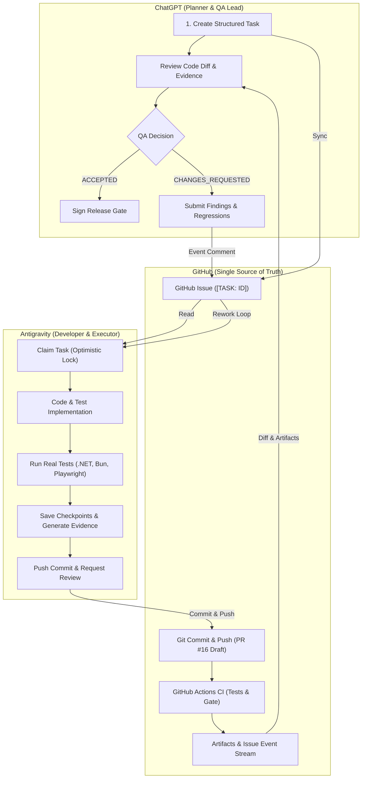

# ZhongWenHub AI Collaboration & Independent QA Bridge — Architecture

## 1. Executive Summary

The **ZhongWenHub AI Collaboration & Independent QA Bridge — V1** establishes an asynchronous, audit-trailed, multi-agent engineering workflow connecting:
- **ChatGPT** (Planner, Lead Architect, Independent QA Reviewer)
- **Antigravity** (Full-Stack Developer, Test Automation Engineer, Release Executor)
- **GitHub** (Shared Single Source of Truth: Issues, PR #16, Actions CI, Git Commits, and Artifacts)

This system eliminates manual copy-pasting of logs and prompts between conversation threads by using structured JSON schemas, atomic Git commits, GitHub CLI event streams, and cryptographic verification.

## 2. Core Principles & Safety Guardrails

1. **Independent Verification**: ChatGPT never treats Antigravity's self-reported success as conclusive evidence. Verification requires verifiable artifacts (commit SHA, test runner TRX/JUnit XML, Playwright traces, and CI check runs).
2. **Strict Zero-Write Dev Database Policy**: `ZhongWenHub_Dev` is completely protected and read-only. All test executions target `ZhongWenHub_Test` with runtime `SELECT DB_NAME()` assertion guards.
3. **Draft Pull Request Protection**: PR #16 must always remain in `Open & Draft` status. No autonomous merging or closing.
4. **Resilience to Timeouts**: The protocol divides complex tasks into modular batches with persistent checkpoints (`checkpoint.schema.json`), enabling seamless crash recovery and resumption.
5. **Secret Sanitization**: All evidence, issue comments, and reports pass through `sanitize_evidence.py` before leaving the local environment.

## 3. Component Architecture

| Component | Responsibility | Technology |
| :--- | :--- | :--- |
| **Protocol Engine** | Validates JSON Draft-07 schemas for tasks, results, reviews, checkpoints | `validate_protocol.py` (Zero dependencies) |
| **Bridge CLI** | CLI orchestrator for task lifecycle management | `bridge.py` |
| **GitHub Engine** | Interacts with GitHub Issues, comments, and PRs | `github_sync.py` via GitHub CLI (`gh`) |
| **Sanitizer** | Regex redactor for connection strings, JWTs, PATs | `sanitize_evidence.py` |
| **CI Workflows** | Automated validation of protocol, backend, frontend, E2E | GitHub Actions |
| **Release Gate** | Multi-criteria technical acceptance evaluator | `release-gate.schema.json` & `bridge-qa-gate.yml` |
