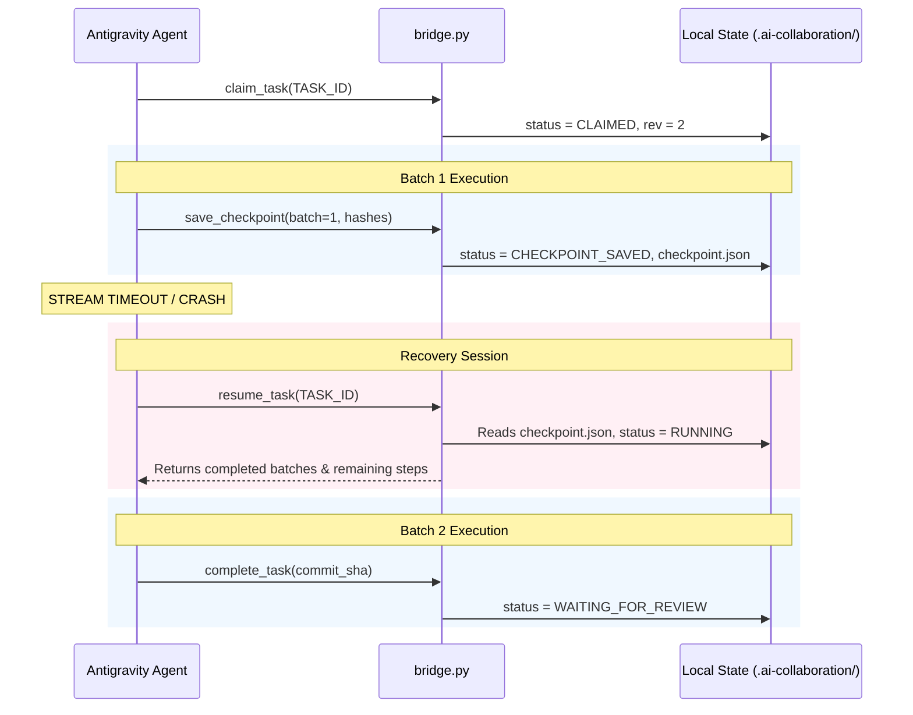

# Crash Recovery & Timeout Resilience

## 1. Problem Statement

AI coding agents frequently encounter network timeouts or context window boundaries (e.g. `API error: stream idle timeout (5m0s): context deadline exceeded`).

When this occurs, an agent session abruptly terminates mid-task. Without robust persistence:
- Work-in-progress code can be corrupted.
- Intermediate outputs are lost.
- Successive sessions duplicate completed work or wipe existing state.

## 2. Recovery Architecture

The Collaboration Bridge implements atomic, batch-oriented checkpoints to solve this:



## 3. Resuming from Checkpoint

When resuming a task:

```bash
python scripts/ai_bridge/bridge.py resume TASK_ID
```

The bridge:
1. Verifies that the task exists and is in `CHECKPOINT_SAVED` or `CLAIMED` status.
2. Reads the latest checkpoint from `.ai-collaboration/state/checkpoints/<TASK_ID>_cp_batch_X.json`.
3. Verifies file hashes of completed deliverables.
4. Transitions task status back to `RUNNING`.
5. Outputs the completed steps and next actionable step to the agent.

