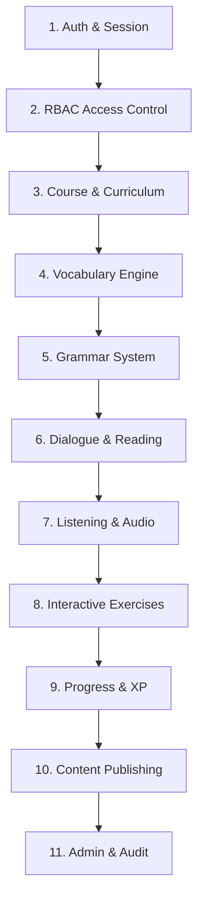

# ZhongWenHub Functional Test Strategy

## 1. Functional Testing Philosophy

ZhongWenHub is an end-to-end educational platform for Chinese language learning (HSK 1 to 6). Functional verification requires testing the system across 11 key operational domains:

## 2. Domain Matrix & Quality Gates

The complete matrix is defined in `.ai-collaboration/qa/functional-test-matrix.json`.

### Domain 1: Authentication & Session
- Valid logins return signed JWT and refresh tokens.
- Invalid credentials yield HTTP 401 with sanitized error responses.
- Protected routes enforce authentication checks.

### Domain 2: Role-Based Access Control (RBAC)
- Roles verified: `ADMIN`, `CONTENT_MANAGER`, `TEACHER`, `STUDENT`, `SUPPORT`.
- Unprivileged users attempting administrative routes (`/admin`) are redirected with 403 Forbidden.
- Content preview endpoints require `CONTENT_MANAGER` or `ADMIN`.

### Domain 3: Course & Curriculum
- HSK 1–6 syllabus navigation respects unit hierarchies.
- `DRAFT` and `PENDING_REVIEW` lessons are concealed from students (returning 404).

### Domain 4: Vocabulary Engine
- Correct rendering of Hanzi, Pinyin with tone marks, Vietnamese definition, and contextual example.
- Text-to-Speech (TTS) fallback using Web Speech API when MP3 audio is unavailable.

### Domain 5: Grammar System
- Grammar rule structures, Vietnamese grammatical explanations, and paired examples.

### Domain 6: Reading Passages
- Unit reading text formatting, vocabulary highlighting, and comprehension questions.

### Domain 7: Listening & Audio
- MP3 audio validation (200 OK, `audio/mpeg` header) and fallback synthesizer.

### Domain 8: Exercises & Scoring
- Multiple-choice questions validate student selection against answer key.
- Clear Vietnamese explanations provided for incorrect answers.
- Submission idempotency: preventing duplicate scoring.

### Domain 9: Progress Tracking & XP
- Real-time XP awarding on lesson completion.
- Duplicate submission prevention: re-completing a lesson does not award duplicate XP.

### Domain 10: Content Publishing
- State machine: `DRAFT -> PENDING_REVIEW -> PUBLISHED`.
- Unauthorized publishing attempts are rejected.

### Domain 11: Admin & Audit
- User management without exposing sensitive credentials.
- Audit log records actions, timestamps, and actor user IDs.

