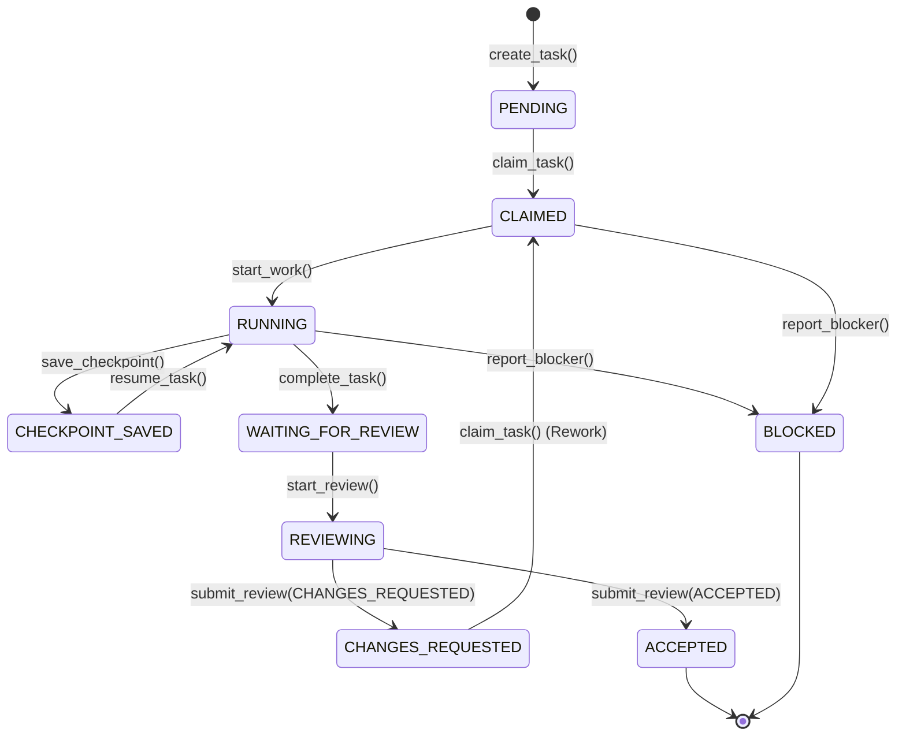

# Task Protocol & State Machine Specification

## 1. Schema & Structure

Tasks are formally defined in `.ai-collaboration/protocol/task.schema.json`. Every task requires:

```json
{
  "schema_version": "1.0.0",
  "task_id": "STRING [A-Z0-9_-]{5,64}",
  "title": "STRING (10-120 chars)",
  "description": "STRING",
  "project": "ZhongWenHub",
  "phase": "STRING",
  "owner": "ChatGPT",
  "reviewer": "ChatGPT",
  "status": "ENUM",
  "revision": "INTEGER (>= 1)",
  "expected_branch": "integration/zhongwenhub-sqlserver",
  "source_commit": "STRING (7-40 hex chars)",
  "input_files": ["ARRAY OF STRINGS"],
  "expected_outputs": ["ARRAY OF STRINGS"],
  "acceptance_criteria": ["ARRAY OF STRINGS"],
  "safety_constraints": ["ARRAY OF STRINGS"],
  "created_at": "ISO8601 DATETIME",
  "updated_at": "ISO8601 DATETIME"
}
```

## 2. State Machine Diagram



## 3. Strict State Transition Rules

1. `PENDING -> ACCEPTED` is strictly prohibited. Work must be executed, evidenced, and independently reviewed.
2. `RUNNING -> ACCEPTED` is strictly prohibited. The executor cannot self-certify.
3. **Optimistic Locking**: Every mutation increments `revision`. If an agent attempts to mutate a task with a stale revision number, the operation is rejected.
4. **Claim Timeout**: A claim includes `claim_expires_at` (default 4 hours). If an agent crashes or abandons a task, another agent can claim it only after expiration.
