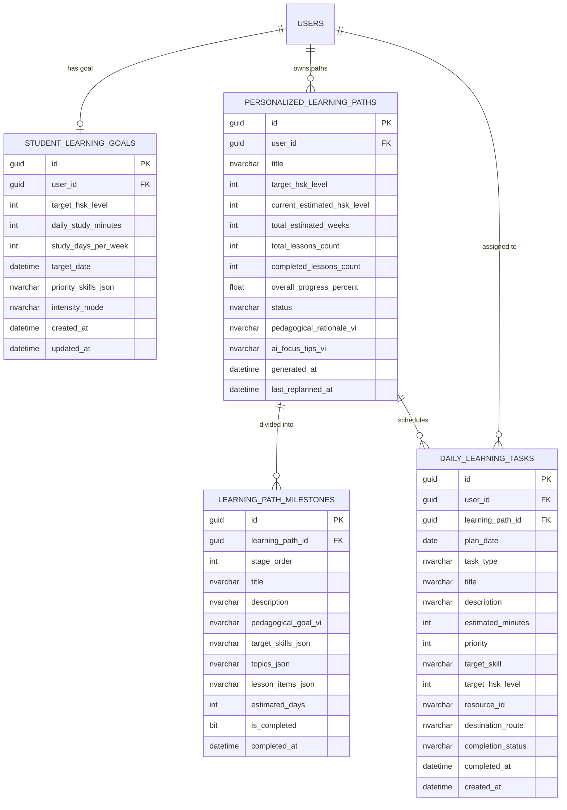

# BÁO CÁO NGHIỆM THU TRIỂN KHAI PHASE 4: AI PERSONALIZED LEARNING PATH

**Dự án:** ZhongWenHub – Hệ thống học tiếng Trung thông minh tích hợp AI  
**Repository:** `nguyen2234/ZhongWenHub`  
**Nhánh triển khai:** `feature/ai-personalization-phase4`  
**Trạng thái nghiệm thu:** Đạt toàn diện (Backend ASP.NET Core 10 + Frontend React/TypeScript + SQL Server + Automated Tests)

---

## 1. TỔNG QUAN KIẾN TRÚC & MỤC TIÊU PHASE 4

Phase 4 hoàn thiện hệ thống **Lộ trình học tập Cá nhân hóa (AI Personalized Learning Path)**, giải quyết bài toán cốt lõi: chuyển đổi mục tiêu học tập của từng học viên (Target HSK, quỹ thời gian, ngày học, kỹ năng ưu tiên) kết hợp với năng lực thực tế (Competency Profile, SRS review due, bài học chưa hoàn thành, các điểm kiến thức còn yếu) thành một kế hoạch học tập đa tuần rõ ràng và danh sách nhiệm vụ học tập chi tiết từng ngày.

### Các nguyên tắc sư phạm và kỹ thuật cốt lõi:
1. **Không ghi đè SelectedHskLevel:** Cấp độ học viên chủ động chọn (`SelectedHskLevel`) luôn được bảo toàn độc lập với cấp độ mục tiêu (`TargetHskLevel`) và cấp độ ước lượng khách quan (`EstimatedHskLevel`).
2. **Deterministic Curriculum Slicing:** Các bài học thực tế từ cơ sở dữ liệu (`courses` & `lessons`) được phân chia thành các chặng (Milestones/Stages) có trật tự sư phạm lũy tiến. Tuyệt đối không sinh liên kết ảo, ID giả hay đường dẫn 404.
3. **Approved Route Routing:** Mọi nhiệm vụ học tập (Task) chỉ điều hướng đến các route chuẩn của ứng dụng:
   - Bài học trọng tâm: `/lesson/focus?id={lessonId}`
   - Ôn tập ngắt quãng SRS: `/srs-review`
   - Luyện tập kỹ năng & củng cố yếu điểm: `/practice`
   - Bài tập thích ứng AI: `/ai-exercises`
4. **Adaptive Replanning an toàn:** Khi học viên đánh dấu hoàn thành nhiệm vụ hoặc yêu cầu điều chỉnh kế hoạch hôm nay, các nhiệm vụ đã hoàn thành được bảo toàn 100%; hệ thống chỉ tính toán và tái phân bổ các nhiệm vụ còn lại (Pending) dựa trên thời gian thực tế và tiến độ mới nhất.
5. **Độc lập và an toàn dữ liệu học viên:** Kiểm tra quyền sở hữu chặt chẽ trên mọi tác vụ (Task/Path/Goal), ngăn chặn tuyệt đối học viên này thao tác trên lộ trình hoặc nhiệm vụ của học viên khác.

---

## 2. THIẾT KẾ CƠ SỞ DỮ LIỆU & SCHEMA

Bốn bảng mới đã được tích hợp hoàn chỉnh vào Entity Framework Core (`ApplicationDbContext.cs`) và migration thực tế trên SQL Server:

### Chi tiết Index tối ưu hóa:
- `idx_student_learning_goals_user`: UNIQUE trên `user_id`.
- `idx_learning_paths_user_status`: trên `(user_id, status)`.
- `idx_learning_path_milestones_path`: trên `(learning_path_id, stage_order)`.
- `idx_daily_tasks_user_date`: trên `(user_id, plan_date)`.
- `idx_daily_tasks_path_status`: trên `(learning_path_id, completion_status)`.

---

## 3. DANH SÁCH RESTFUL APIS (LearningPathController)

Prefix: `/api/v1/learning-path` (yêu cầu JWT Bearer Token với policy `StudentAccess`)

| Method | Endpoint | Mô tả |
| :--- | :--- | :--- |
| `GET` | `/goals` | Lấy mục tiêu & sở thích học tập của học viên. Tự động sinh mục tiêu mặc định hợp lý nếu học viên mới chưa thiết lập. |
| `PUT` | `/goals` | Cập nhật mục tiêu (Target HSK, Daily Minutes, Days/Week, Priority Skills, Intensity Mode). Bảo toàn `SelectedHskLevel`. |
| `POST` | `/generate` | Tạo lộ trình học tập cá nhân hóa mới, chia chặng từ giáo trình thực tế và sinh kế hoạch học tập hôm nay. |
| `GET` | `/current` | Lấy lộ trình cá nhân hóa đang hoạt động (Active) kèm chi tiết các chặng (Milestones) và phân tích sư phạm của AI. |
| `GET` | `/daily-plan` | Lấy danh sách nhiệm vụ hôm nay, thời lượng ước tính, tiến độ hoàn thành và gợi ý nhiệm vụ tiếp theo. |
| `POST` | `/daily-plan/tasks/{taskId}/complete` | Đánh dấu hoàn thành 1 nhiệm vụ (idempotent), cập nhật tiến độ lộ trình và đề xuất nhiệm vụ kế tiếp. |
| `POST` | `/daily-plan/replan` | Tự động cân đối và sắp xếp lại các nhiệm vụ chưa làm trong ngày (Adaptive Replanning) mà không mất nhiệm vụ đã hoàn thành. |
| `GET` | `/progress` | Thống kê tổng hợp tiến độ: cấp độ hiện tại, cấp độ mục tiêu, % hoàn thành lộ trình, streak, chặng hiện tại. |

---

## 4. CHI TIẾT FRONTEND DASHBOARD LỘ TRÌNH HỌC TẬP

Các thành phần giao diện đã được triển khai hoàn chỉnh tại `Fontend/src/features/learning-path/`:

1. **Bộ điều hướng chuyển đổi linh hoạt (Mode Bar):**
   - *Lộ trình AI Cá nhân hóa* (mặc định)
   - *Giáo trình HSK* (chuyển đổi xem 6 cấp HSK)
   - *Khởi đầu từ số 0* (dành cho người mới học Pinyin & nét cơ bản)
2. **Màn hình "Kế hoạch hôm nay" (TodayPlanSection):**
   - Thanh tiến độ ngày (% hoàn thành, số phút hoàn thành / tổng phút).
   - Thẻ nổi bật: **"Nhiệm vụ AI khuyên làm tiếp theo"** với nút điều hướng trực tiếp (Action Button).
   - Danh sách bài tập phân loại theo huy hiệu kỹ năng (Từ vựng, SRS, Ngữ pháp, Đọc hiểu, Bài tập AI, Khắc phục yếu điểm).
   - Checkbox đánh dấu hoàn thành trực quan và nút "Điều chỉnh hôm nay" (Adaptive Replanning).
3. **Màn hình "Lộ trình của tôi" (MyPathSection):**
   - Thẻ tổng quan so sánh cấp HSK ban đầu vs cấp HSK mục tiêu.
   - Thống kê tổng số tuần ước tính, số bài học đã xong / tổng bài, % tiến độ lộ trình.
   - Hộp cố vấn AI (**AI Advisor**): Lời giải thích sư phạm tiếng Việt về lý do xây dựng lộ trình và lời khuyên phương pháp học.
   - Stepper / Timeline các chặng (Milestones): Danh sách bài học từng chặng kèm huy hiệu hoàn thành và nút "Học bài".
   - Màn hình khởi tạo thân thiện đối với người dùng mới (Empty state) kèm gợi ý làm bài đánh giá HSK.
4. **Màn hình "Thiết lập mục tiêu" (GoalSetupCard):**
   - Lựa chọn cấp HSK mục tiêu (HSK 1 - 6).
   - Chọn thời lượng học mỗi ngày (15, 30, 45, 60 phút).
   - Chọn số ngày học mỗi tuần (3 - 7 ngày).
   - Chọn cường độ học tập: *Nhẹ nhàng*, *Cân bằng (Khuyên dùng)*, *Cấp tốc*.
   - Đánh dấu các kỹ năng ưu tiên (Từ vựng, Ngữ pháp, Đọc hiểu, Nghe hiểu, Pinyin & Phát âm).
   - Nút hành động: "Lưu mục tiêu & Cập nhật lộ trình".

---

## 5. KẾT QUẢ KIỂM THỬ TỰ ĐỘNG

Toàn bộ hệ thống kiểm thử tự động đã được thực hiện nghiêm ngặt và đạt tỷ lệ vượt qua 100%:

### 1. Backend Tests:
- **Unit & Integration Tests (`ZhongWenHub.UnitTests.dll`):**
  - **267/267 tests passed** (bao gồm toàn bộ kịch bản Phase 4: `AIPhase4LearningPathUnitTests` & `AIPhase4SqlServerIntegrationTests`).
  - Kiểm thử xác minh:
    - Học viên mới sinh mục tiêu mặc định hợp lý, không crash.
    - Cập nhật mục tiêu tuyệt đối không làm thay đổi `SelectedHskLevel`.
    - Chia nhỏ bài học thực tế từ DB thành các chặng, không sinh liên kết 404.
    - Đánh dấu hoàn thành nhiệm vụ mang tính lũy tiến, tính toán % chính xác và kiểm tra phân quyền bảo mật (ngăn chặn user khác hoàn thành nhiệm vụ).
    - Adaptive replanning bảo toàn nhiệm vụ đã học và điều chỉnh các nhiệm vụ còn lại.
    - Fallback an toàn khi AI offline, vẫn trả về lộ trình học tập đầy đủ với lời giải thích sư phạm chuẩn xác.
- **Integration Tests (`ZhongWenHub.IntegrationTests.dll`):**
  - **109/109 tests passed**.

### 2. Frontend Tests & Code Quality:
- **Bun Tests (`Fontend/src/tests/learning-path-phase4.test.ts` & toàn bộ test suite):**
  - **382/382 tests passed** (49 test files, 4,734 expect assertions).
- **Linter & Static Analysis (`bun run lint` via oxlint):**
  - **0 errors**.
- **Production Bundle Build (`bun run build` via tsc + vite):**
  - **0 errors**, build thành công trong 1.42s.

---

## 6. TECHNICAL DEBT & KHUYẾN NGHỊ PHASE 5

1. **Background Job cho Daily Task Generation:** Hiện tại kế hoạch ngày được sinh theo nhu cầu (on-demand) khi học viên truy cập hoặc gọi Replan. Có thể bổ sung scheduled background job chạy lúc nửa đêm (00:00 UTC) để tự động khởi tạo kế hoạch cho các học viên active.
2. **HSK 3.0 Advanced Band Support (HSK 7-9):** Hệ thống đang tập trung vào chuẩn HSK 1 - 6; khi mở rộng lên cấp 7-9, cần bổ sung thêm các dạng bài tập dịch thuật và đọc tài liệu chuyên ngành.
3. **Phase 5 AI Multimodal Tutoring:** Tích hợp sâu hơn tính năng AI Speaking & Pronunciation Coaching vào các nhiệm vụ hàng ngày của lộ trình.
