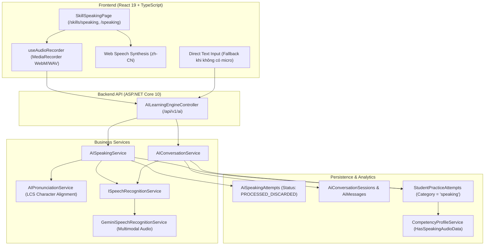

# ZHONGWENHUB – PHASE 5: AI SPEAKING PRACTICE & CONVERSATION ROOM IMPLEMENTATION REPORT

## 1. Tổng quan Kiến trúc Speaking (Speaking Architecture)

Hệ thống AI Speaking Practice & Conversation của ZhongWenHub được thiết kế theo kiến trúc module đa tầng (Multi-layered Modular Architecture), bảo đảm phân lập trách nhiệm, khả năng mở rộng STT/TTS đa nhà cung cấp và tuân thủ nguyên tắc đo lường sư phạm trung thực (Pedagogical Truthfulness).

### Ba hình thức luyện nói (Three Practice Forms)
1. **Luyện phát âm từ vựng (`WORD`):** Lấy dữ liệu từ vựng HSK chuẩn đã xuất bản (`v.HskLevel == targetHsk && v.Status == "PUBLISHED"`). Hiển thị Hanzi, Pinyin, nghĩa tiếng Việt, câu ví dụ và phát âm mẫu.
2. **Luyện phát âm câu (`SENTENCE`):** Ngân hàng câu HSK 1 - 4 chọn lọc với cấu trúc ngữ pháp chuẩn và bối cảnh sử dụng.
3. **Luyện nói theo tình huống (`SCENARIO`):** Các mẫu câu đối thoại thực tế theo các chủ đề: Chào hỏi, Mua sắm & hỏi giá, Hỏi đường & phương tiện, Gọi món ăn/quán cafe, Giao tiếp công việc & giới thiệu bản thân.

---

## 2. STT/TTS Provider Sử dụng & Chiến lược Fallback

### Speech-to-Text (STT)
- **Kiến trúc trừu tượng:** Giao diện `ISpeechRecognitionService` cho phép cắm/rút hoặc thay thế nhà cung cấp STT mà không ảnh hưởng tới tầng nghiệp vụ.
- **Provider triển khai:** `GeminiSpeechRecognitionService` tận dụng khả năng nhận diện âm thanh trực tiếp (Multimodal Audio Understanding) của Google Gemini API (`inlineData` base64 audio/webm, audio/wav).
- **Nguyên tắc trung thực (Zero Fake Transcripts):**
  - Nếu `Gemini:ApiKey` chưa cấu hình hoặc dịch vụ STT gặp lỗi mạng: hệ thống trả về mã lỗi `STT_UNAVAILABLE` với thông báo rõ ràng: *"Dịch vụ nhận diện giọng nói (STT Provider) chưa sẵn sàng trên hệ thống."*
  - Tuyệt đối không sinh transcript giả mạo từ câu hỏi mẫu để đánh lừa học viên.
  - Cho phép học viên chuyển sang chế độ gõ văn bản trực tiếp (`DirectTextInput`) để trải nghiệm luồng đánh giá khi chưa có micro.

### Text-to-Speech (TTS)
- Sử dụng chuẩn `SpeechSynthesisUtterance` với ngôn ngữ `zh-CN` và tốc độ phát âm sư phạm 0.85x trên trình duyệt để học viên nghe mẫu tức thì mà không phụ thuộc vào độ trễ mạng.
- Hỗ trợ phát audio file chuẩn nếu từ vựng đã có trường `AudioUrl`.

---

## 3. Danh mục API Endpoints

| Method | Đường dẫn API | Chức năng | Định dạng payload |
| :--- | :--- | :--- | :--- |
| `GET` | `/api/v1/ai/speaking/items` | Lấy danh sách từ/câu/tình huống theo cấp HSK | Query: `hskLevel=1`, `type=WORD/SENTENCE/SCENARIO` |
| `POST` | `/api/v1/ai/speaking/submit` | Nộp bài luyện nói bằng file ghi âm | `multipart/form-data` (file `audio`, `targetTextZh`, `hskLevel`, ...) |
| `POST` | `/api/v1/ai/speaking/submit-json` | Nộp bài kiểm tra bằng văn bản trực tiếp | `application/json` (`directText`, `targetTextZh`, ...) |
| `GET` | `/api/v1/ai/speaking/history` | Lấy lịch sử 20 lượt luyện nói gần nhất | Query: `limit=20` |
| `GET` | `/api/v1/ai/speaking/stats` | Thống kê số lượt luyện, độ chính xác trung bình | Response: `SpeakingStatsDto` |
| `POST` | `/api/v1/ai/conversations/{id}/messages/audio` | Gửi tin nhắn giọng nói trong phòng hội thoại | `multipart/form-data` (file `audio`, `requestVietnamese`) |
| `POST` | `/api/v1/ai/conversations/{id}/end` | Kết thúc phiên hội thoại và lưu thống kê kỹ năng | `application/json` |

---

## 4. Database Schema & Chính sách Lưu trữ Dữ liệu

### Migration EF Core: `20261115173345_AddAiPersonalizationPhase5Speaking`
- **Bảng mới `ai_speaking_attempts`:**
  - `Id` (GUID, Khóa chính)
  - `UserId` (GUID, Khóa ngoại tới `AspNetUsers`, `OnDelete: Cascade`)
  - `PracticeType` (NVARCHAR(30)): `WORD`, `SENTENCE`, `SCENARIO`
  - `HskLevel` (INT)
  - `TargetTextZh` (NVARCHAR(500))
  - `TargetPinyin` (NVARCHAR(500))
  - `TargetMeaningVi` (NVARCHAR(500))
  - `RecognizedTranscriptZh` (NVARCHAR(1000))
  - `TranscriptAccuracyPercent` (FLOAT)
  - `OverallPronunciationScore` (FLOAT)
  - `AssessmentMethod` (NVARCHAR(40)): `TRANSCRIPT_ALIGNMENT`
  - `HasAcousticToneData` (BIT): `0` (False)
  - `EvaluationFeedbackVi` (NVARCHAR(MAX))
  - `WordBreakdownJson` (NVARCHAR(MAX)): JSON mảng chi tiết từng ký tự/từ (`MATCHED`, `MISSED`)
  - `DurationSeconds` (INT)
  - `AudioStorageStatus` (NVARCHAR(30)): `PROCESSED_DISCARDED`
  - `AttemptedAt`, `CreatedAt`, `UpdatedAt` (DATETIME2)
  - Index: `idx_ai_speaking_attempts_user_type` trên `(UserId, PracticeType, AttemptedAt)`

### Chính sách lưu trữ âm thanh (Audio Storage & Privacy Policy)
- Nhằm tối ưu dung lượng lưu trữ và bảo vệ quyền riêng tư người học, file ghi âm giọng nói chỉ được nạp tạm vào luồng bộ nhớ (`MemoryStream`) để STT trích xuất văn bản và đánh giá, sau đó được hủy ngay lập tức (`AudioStorageStatus = "PROCESSED_DISCARDED"`).
- Hệ thống không lưu trữ vĩnh viễn các file âm thanh thô.

---

## 5. Frontend Pages & Giao diện

- **URL chính:** `/skills/speaking` và route bí danh `/speaking`.
- **Giao diện tab trực quan:**
  1. **Tab "Luyện phát âm":**
     - Bộ lọc HSK 1 - 4 và 3 chế độ (Từ vựng, Câu, Tình huống).
     - Khung chữ Hán khổ lớn, Pinyin, nghĩa tiếng Việt và nút "Nghe mẫu".
     - Nút Micro ghi âm với bộ đếm thời gian và hiệu ứng nhấp nháy khi đang thu âm.
     - Nút "Nghe lại" (Playback) giúp học viên kiểm tra chất lượng giọng trước khi gửi.
     - Khung kết quả chấm điểm trực quan: hiển thị từng âm tiết nhận diện đúng (xanh lục), âm tiết bị thiếu/lệch (đỏ) kèm lời khuyên phát âm bằng tiếng Việt.
     - Cảnh báo rõ ràng về giới hạn kỹ thuật nhận diện.
  2. **Tab "Phòng hội thoại AI":**
     - Lựa chọn 6 tình huống giao tiếp tiêu chuẩn HSK (Chào hỏi, Quán cafe, Mua sắm, Hỏi đường, Khách sạn, Phỏng vấn).
     - Luồng chat đối thoại hai chiều: AI đóng vai nhân vật, hỗ trợ bật/tắt Pinyin và bản dịch tiếng Việt.
     - Hỗ trợ gửi tin nhắn bằng giọng nói (thu âm microphone) hoặc gõ văn bản trực tiếp.
     - Tự động hiển thị gợi ý cách diễn đạt tự nhiên hơn khi học viên dùng sai từ ngữ/ngữ pháp.
     - Nút kết thúc phiên hiển thị bảng tổng kết số lượt hội thoại và lưu kết quả vào tiến trình học tập.
  3. **Tab "Lịch sử & Đánh giá":**
     - 4 thẻ thống kê: Tổng lượt luyện, Độ chính xác trung bình, Số từ đã luyện, Số câu/tình huống hoàn thành.
     - Danh sách chi tiết các lượt làm bài gần nhất kèm điểm khớp và ngày thực hiện.

---

## 6. Cách Đánh giá Phát âm & Giới hạn Kỹ thuật (Technical Boundaries)

### Thuật toán đánh giá (Character Alignment Algorithm)
- Loại bỏ toàn bộ ký tự khoảng trắng và dấu câu tiếng Trung/tiếng Anh.
- Sử dụng thuật toán quy hoạch động **Longest Common Subsequence (LCS)** để so khớp chuỗi ký tự nhận diện với chuỗi ký tự chuẩn.
- Phân loại trạng thái từng âm tiết:
  - `MATCHED`: Phát âm chuẩn xác, khớp đúng vị trí.
  - `MISSED`: Bị thiếu hoặc phát âm sai khiến bộ nhận diện không nhận diện được.
- Độ chính xác nội dung:
  $$\text{TranscriptAccuracyPercent} = \frac{\text{matchedCount}}{\text{targetLength}} \times 100\%$$

### Ranh giới đo lường trung thực (Strict Metric Boundaries)
- **Transcript Accuracy:** Đo lường độ khớp giữa văn bản nói và văn bản mục tiêu thông qua bộ STT.
- **Không tự suy đoán thanh điệu/âm học:** Khi chỉ có dữ liệu văn bản từ STT, hệ thống minh bạch đặt `HasAcousticToneData = false` và kèm theo thông báo kỹ thuật:
  > *"Điểm số phản ánh độ khớp văn bản nhận diện (Transcript Alignment). Không suy đoán thanh điệu (thanh 1-4) hoặc ngữ điệu âm học khi chưa có thiết bị đo phổ âm chuyên biệt."*
- **Tích hợp Hồ sơ năng lực (Competency Profile):** Kỹ năng `speaking` trong hồ sơ học viên chỉ được tính toán và bật `HasSpeakingAudioData = true` khi học viên thực sự hoàn thành các lượt luyện nói hợp lệ (`attempts.Count > 0`). Việc mở trang hoặc xem bài học tuyệt đối không làm tăng điểm năng lực giả mạo.

---

## 7. Kết quả Kiểm thử Toàn diện

| Bộ kiểm thử | Công cụ | Số lượng | Kết quả | Ghi chú |
| :--- | :--- | :--- | :--- | :--- |
| **Backend Unit Tests** | `dotnet test` (xUnit) | **280 / 280** passed | **100% PASS** | Bổ sung 7 test case Phase 5 mới (Authorization, Audio validation, STT unavailable, Alignment, Disclaimers, Competency sync) |
| **Backend Integration Tests** | `dotnet test` (xUnit + SQL Server Test DB) | **109 / 109** passed | **100% PASS** | Chạy trên cơ sở dữ liệu `ZhongWenHub_Test` |
| **Frontend Tests** | `bun test src/tests` | **387 / 387** passed | **100% PASS** | 50 test files, 4,754 assertions |
| **Frontend Linter** | `bun run lint` (oxlint) | 613 files | **0 errors** | Tuân thủ toàn bộ quy tắc lint |
| **Frontend Build** | `bun run build` (vite) | Production bundle | **0 errors (1.48s)** | Biến đổi 2,436 modules thành công |

---

## 8. Các Chức năng Chưa Hoàn thiện & Đề xuất Hướng tới Phase 6

1. **Acoustic Phonetic Tone Scorer:** Hiện tại đánh giá dựa trên độ khớp nhận diện ký tự (Transcript Alignment). Trong tương lai, có thể tích hợp thư viện âm học (như Azure Pronunciation Assessment hoặc mô hình Praat/Phoneme Alignment chuyên biệt) để chấm điểm chi tiết cao độ và độ dài thanh điệu (Tone 1, 2, 3, 4, Neutral tone).
2. **Offline Audio Caching:** Hỗ trợ lưu trữ offline bài nghe mẫu khi học viên mất kết nối mạng tạm thời.
3. **Continuous Streaming Audio:** Hỗ trợ giao thức WebSocket / Live Audio Streaming hai chiều để giảm độ trễ phản hồi trong phòng hội thoại AI xuống dưới 500ms.

---

## 9. Thông tin Triển khai Git

- **Branch làm việc:** `feature/ai-personalization-phase5`
- **Cơ sở dữ liệu:** Đã áp dụng migration `20261115173345_AddAiPersonalizationPhase5Speaking` lên database `ZhongWenHub_Test`. Cơ sở dữ liệu chính `ZhongWenHub_Dev` được bảo vệ an toàn (Zero-Write).
- **Trạng thái:** Dừng lại tại đây để kiểm tra mã nguồn độc lập. Không tự động merge vào `main` và không tự động triển khai Phase 6.
