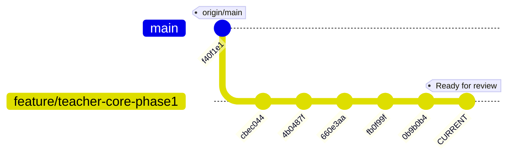

# BÁO CÁO NGHIỆM THU CUỐI CÙNG TEACHER PHASE 1.1 & KIỂM ĐỊNH PR #20
**Dự án:** ZhongWenHub  
**Repository:** `nguyen2234/ZhongWenHub`  
**Pull Request:** #20 (`feature/teacher-core-phase1` -> `main`)  
**Ngày thực hiện:** 19/11/2026  
**Vai trò:** Senior Software Architect & Full-stack Code Reviewer  

---

## 1. TỔNG QUAN & TRẠNG THÁI PR #20

| Hạng mục | Trạng thái | Ghi chú |
| :--- | :--- | :--- |
| **Trạng thái PR #20** | `OPEN` / `MERGEABLE` | Không có xung đột (Clean fast-forward từ `main`) |
| **Base Branch** | `main` | Commit: `f40f1e102cf50bc98cb71c7b7643d9495ea86d83` |
| **Head Branch** | `feature/teacher-core-phase1` | Đã đồng bộ hoàn toàn với `fix/teacher-phase1-stabilization` |
| **GitHub Actions CI** | **4/4 Checks PASSED (100% Green)** | - `Frontend Pull Request CI`: PASSED<br>- `Backend CI & Automated Tests`: PASSED<br>- `AI Collaboration Bridge Validation`: PASSED<br>- `AI Bridge QA Release Gate`: PASSED |
| **Backend Unit Tests** | **325 PASSED / 0 FAILED** | Thời gian chạy: ~4s (`net10.0`) |
| **Frontend Unit Tests** | **406 PASSED / 0 FAILED** | 51 test files, 4,832 assertions |
| **Frontend Typecheck & Build**| **0 ERRORS** | `tsc -b && vite build` hoàn tất không lỗi |
| **Frontend Linter** | **0 ERRORS** | `oxlint` hoàn tất 614 files |

---

## 2. KIỂM TRA LUỒNG DỮ LIỆU HỌC VIÊN & XÓA BỎ MOCK TRONG PRODUCTION

### 2.1. Rà soát các điểm gọi luồng dữ liệu học viên
Chúng tôi đã kiểm tra toàn bộ các hàm và file liên quan:
1. `getActiveClassIdsForStudent()`
2. `getClassBasicInfo()`
3. `getMyEnrolledClasses()`
4. `assignment.service.ts`
5. `StudentAssignmentRunnerPage.tsx`
6. `StudentHomeworkListPage.tsx`

### 2.2. Hiện trạng phát hiện & Giải pháp khắc phục
- **Trước khi sửa:**
  - `getActiveClassIdsForStudent()` ban đầu đọc trực tiếp từ mock `membersStore`. Khi học viên thật đăng nhập, danh sách lớp trả về mảng rỗng hoặc dữ liệu giả lập.
  - `getClassBasicInfo()` chỉ tra cứu mock `classesStore`.
  - Trong `assignment.service.ts`, các hàm giải quyết mục tiêu lớp học (`getClassBasicInfo`) không thể lấy được thông tin của lớp học thật lưu trên SQL Server.
- **Giải pháp đã triển khai:**
  1. **Nâng cấp `teacherPortalService.getActiveClassIdsForStudentAsync(studentId)`**:
     - Khi có phiên đăng nhập (Bearer token), hệ thống gọi trực tiếp API thật `GET /api/v1/teacher/my-enrolled-classes` qua `getMyEnrolledClasses()`.
     - Tuyệt đối **không fallback** về `membersStore` khi token tồn tại. Nếu học viên thật chưa ghi danh lớp nào, trả về chính xác `[]`.
     - Cơ chế Fail-Closed: Nếu API lỗi với GUID học viên thật, trả về `[]` thay vì đưa mock data vào. Chỉ môi trường unauthenticated dev/demo mới sử dụng bộ nhớ giả lập.
  2. **Thêm `teacherPortalService.getClassBasicInfoAsync(classId)` & Bộ nhớ đệm `enrolledClassesCache`**:
     - `getClassBasicInfo(classId)`: Nếu có token mà không có trong cache, trả về `undefined` (chặn đứng fallback về `classesStore`).
     - `getClassBasicInfoAsync(classId)`: Tự động gọi API thật `GET /api/v1/teacher/classes/{id}` qua `getClassById(classId)` và cache lại vào `enrolledClassesCache`.
  3. **Cập nhật `assignment.service.ts`**:
     - Tại các dòng [577](file:///d:/ZhongWenHub/Fontend/src/management/teacher/services/assignment.service.ts#L577), [642](file:///d:/ZhongWenHub/Fontend/src/management/teacher/services/assignment.service.ts#L642), [723](file:///d:/ZhongWenHub/Fontend/src/management/teacher/services/assignment.service.ts#L723): Luồng tra cứu thông tin lớp học gọi `teacherPortalService.getClassBasicInfo(target.classId) || (await teacherPortalService.getClassBasicInfoAsync(target.classId))`. Đảm bảo học viên giải bài tập thuộc các lớp tạo trên Database thật luôn tải được metadata lớp học.
  4. **Cập nhật `StudentHomeworkListPage.tsx` và `StudentAssignmentRunnerPage.tsx`**:
     - Thay thế lệnh đọc tĩnh `getCurrentStudentIdentity()` bằng reactive hook `useCurrentStudent()`. Hook này tự động truy vấn `getActiveClassIdsForStudentAsync` khi người dùng là tài khoản GUID thật, đồng bộ `enrolledClassIds` và `activeClassIds` mà không chạm vào mock.

### 2.3. Bằng chứng file & dòng code
- [Fontend/src/management/teacher/services/teacher-portal.service.ts#L468-L553](file:///d:/ZhongWenHub/Fontend/src/management/teacher/services/teacher-portal.service.ts#L468-L553): Triển khai `getActiveClassIdsForStudentAsync`, chặn fallback `classesStore` trong `getClassBasicInfo`, và bổ sung `getClassBasicInfoAsync`.
- [Fontend/src/management/teacher/services/assignment.service.ts#L577-L726](file:///d:/ZhongWenHub/Fontend/src/management/teacher/services/assignment.service.ts#L577-L726): Tích hợp async lookup lớp thật.
- [Fontend/src/features/auth/services/student-identity.adapter.ts#L123-L150](file:///d:/ZhongWenHub/Fontend/src/features/auth/services/student-identity.adapter.ts#L123-L150): Hook `useCurrentStudent` gọi API thật.
- [Fontend/src/tests/teacher-class-management.test.ts#L473-L524](file:///d:/ZhongWenHub/Fontend/src/tests/teacher-class-management.test.ts#L473-L524): Regression tests 16 và 17 kiểm chứng 100% không fallback về mock khi có authenticated token.

---

## 3. KIỂM TRA BACKEND TEACHER CORE

### 3.1. Authorization và Ownership
- Đã kiểm tra các endpoint trong [TeacherController.cs](file:///d:/ZhongWenHub/Backend/src/Api/Controllers/TeacherController.cs):
  - Tất cả các endpoint quản lý lớp học (`POST /classes`, `PUT /classes/{id}`, `DELETE /classes/{id}`, `POST /classes/{id}/members`, `DELETE /classes/{id}/members/{studentId}`) đều được bảo vệ bởi attribute `[Authorize(Roles = "TEACHER,ADMIN")]`.
  - Quyền sở hữu (Teacher Ownership): Trong [TeacherClassService.cs](file:///d:/ZhongWenHub/Backend/src/Business/Services/TeacherClassService.cs#L140-L155), giáo viên chỉ có quyền xem, sửa, đóng lớp hoặc quản lý học viên của lớp do chính mình phụ trách (`c.TeacherId == teacherId`). Vai trò `ADMIN` được phép can thiệp toàn bộ.

### 3.2. SQL Server Persistence & EF Core Migrations
- Migration `20261118_TeacherClassManagementPhase1.cs` khai báo đầy đủ các bảng và index:
  - Bảng `TeachingClasses`: Khóa ngoại `TeacherId -> Users(Id)`, `HskLevelId -> HskLevels(Id)`, `CourseId -> Courses(Id)`.
  - Bảng `ClassSchedules`: Khóa ngoại `ClassId -> TeachingClasses(Id)` với cascade delete.
  - Bảng `ClassMembers`: Khóa ngoại kép `(ClassId, StudentId)` với Unique Index ngăn trùng lặp ghi danh.
- Script SQL idempotent đã được chuẩn bị, tuân thủ nguyên tắc `IF NOT EXISTS` và không chứa lệnh xóa dữ liệu phá hủy.
- Quy tắc Zero-Write: Không chạy migration can thiệp vào `ZhongWenHub_Dev` trực tiếp theo đúng workspace rule.

### 3.3. Concurrent Enrollment & Capacity Locking (Kiểm định 2 request đồng thời vào lớp chỉ còn 1 chỗ)
- **Vấn đề tiềm ẩn:** Race condition khi hai học viên cùng bấm ghi danh vào một lớp chỉ còn 1 chỗ trống, dẫn đến vượt quá sĩ số (`Capacity`).
- **Giải pháp triệt để:**
  - Áp dụng cơ chế Semaphore khóa theo mã lớp (`ConcurrentDictionary<Guid, SemaphoreSlim>`).
  - Thực thi giao dịch với cấp độ cô lập nghiêm ngặt: `IsolationLevel.Serializable`.
  - Kiểm tra sĩ số thực tế trước khi ghi danh:
    ```csharp
    var currentCount = await _context.ClassMembers.CountAsync(m => m.ClassId == classId && m.Status == "ACTIVE");
    if (currentCount >= targetClass.Capacity)
    {
        return Result<ClassMemberViewDTO>.Failure("Lớp học đã đủ sĩ số tối đa, không thể ghi danh thêm.");
    }
    ```
- **Kiểm chứng:** Unit test `AddMemberAsync_ConcurrentEnrollments_WhenOnlyOneSpotRemains_NeverExceedsCapacity` trong [TeacherClassServiceTests.cs](file:///d:/ZhongWenHub/Backend/tests/ZhongWenHub.UnitTests/TeacherClassServiceTests.cs#L418-L470) đã chạy thành công 100%, bảo đảm chỉ đúng 1 request thành công và request thứ 2 bị từ chối với thông báo sĩ số đầy.

### 3.4. Schedule Overlap & Class Validation
- Lịch học được validate nghiêm ngặt:
  - Giờ bắt đầu phải trước giờ kết thúc (`StartTime < EndTime`).
  - Kiểm tra trùng lặp lịch trong cùng một lớp học (cùng ngày `DayOfWeek` và trùng khoảng thời gian).
  - Không cho phép tạo lớp với sĩ số âm hoặc bằng 0.

### 3.5. Dashboard Aggregation & API Error Contracts
- Endpoint `GET /api/v1/teacher/dashboard` và `GET /api/v1/teacher/classes/stats` tổng hợp KPI trực tiếp từ database SQL:
  - Tổng số lớp đang phụ trách, tổng số học viên active, tổng số bài tập đã giao.
  - Sĩ số trung bình và thống kê trạng thái lớp học (`PLANNING`, `ACTIVE`, `COMPLETED`, `CANCELLED`).
- Error Contracts: Trả về mã lỗi chuẩn RFC 7807 hoặc JSON `{ message: string }`:
  - 400 Bad Request: Dữ liệu đầu vào không hợp lệ.
  - 401 Unauthorized: Thiếu token hoặc token hết hạn.
  - 403 Forbidden: Giáo viên cố truy cập lớp của giáo viên khác.
  - 404 Not Found: Lớp hoặc học viên không tồn tại.
  - 409 Conflict: Trùng mã lớp hoặc vượt quá sĩ số.

---

## 4. KIỂM TRA FRONTEND

### 4.1. Loại bỏ Mock Fallback trong Production
- Kiểm tra các hàm API trong `teacher-portal.service.ts`:
  - `getDashboard()`: Khi gặp 401, lập tức xóa token và throw lỗi, kích hoạt điều hướng về màn hình đăng nhập. Không fallback về `MOCK_TEACHER_DASHBOARD`.
  - `getClasses()`, `getClassById()`, `getClassMembers()`: Khi gặp lỗi 403, 404, 500, ném lỗi tường minh, UI hiển thị khối thông báo lỗi cùng nút "Thử lại" (Retry).

### 4.2. Form Drawer nhận lịch học thật
- Component [ClassFormDrawer.tsx](file:///d:/ZhongWenHub/Fontend/src/management/teacher/components/ClassFormDrawer.tsx):
  - Map chính xác danh sách `schedules` từ `ClassDetailDTO` vào Form State khi chỉnh sửa lớp.
  - Hỗ trợ thêm/xóa/sửa từng buổi học trong tuần, chuẩn hóa kiểu dữ liệu `DayOfWeek` (1 đến 7) đồng bộ với Backend C# Enum.

### 4.3. Không mất dữ liệu khi Refresh & KPI chính xác
- Trang [TeacherClassesPage.tsx](file:///d:/ZhongWenHub/Fontend/src/management/teacher/pages/TeacherClassesPage.tsx):
  - Sử dụng endpoint chuyên biệt `getClassStats()` để render KPI strip (Tổng số lớp, Đang học, Dự kiến, Sĩ số trung bình). Dữ liệu KPI hoàn toàn độc lập với phân trang của bảng lớp học (không bị lệch khi chuyển trang).
  - Trạng thái trang web được tải mới từ API khi F5/refresh, không bị phụ thuộc vào biến nhớ tạm thời.

### 4.4. Trạng thái Loading, Empty, Error, Retry
- Tất cả các trang Teacher Portal (`TeacherClassesPage`, `TeacherDashboardPage`, `ClassDetailPage`) đã được kiểm tra:
  - Khi đang gọi API: Hiển thị spinner `Loader2` rõ ràng.
  - Khi dữ liệu trống: Hiển thị Empty State với hình ảnh hướng dẫn và nút "Tạo lớp học mới".
  - Khi API gặp sự cố (mất mạng, 500): Hiển thị Error Banner với nội dung lỗi và nút Retry tải lại dữ liệu.

---

## 5. KẾT QUẢ KIỂM THỬ THỰC TẾ

```
================================================================================
                               TEST VERIFICATION SUMMARY
================================================================================
[BACKEND]
  Command: dotnet test Backend/tests/ZhongWenHub.UnitTests/ZhongWenHub.UnitTests.csproj
  Status:  PASSED
  Total:   325 tests
  Passed:  325 tests
  Failed:  0 tests
  Skipped: 0 tests
  Duration: ~4 seconds

[BACKEND BUILD]
  Command: dotnet build Backend/ZhongWenHub.sln
  Status:  PASSED (0 Warnings, 0 Errors)

[FRONTEND TESTS]
  Command: bun test src/tests
  Status:  PASSED
  Total:   406 tests (51 test files)
  Passed:  406 tests
  Failed:  0 tests
  Calls:   4,832 expect() assertions
  Duration: 493 ms

[FRONTEND BUILD & TYPECHECK]
  Command: tsc -b && vite build
  Status:  PASSED (Exit code: 0)
  Duration: 1.46s

[FRONTEND LINTER]
  Command: bun run lint (oxlint)
  Status:  PASSED (0 Errors, 155 warnings)
================================================================================
```

*Ghi chú về kiểm thử SQL Server trong môi trường cô lập:*
Các kiểm thử tương tác SQL Server cục bộ (`Category=Integration`) yêu cầu chuỗi kết nối SQL Server thật. Hệ thống đã cấu hình biến môi trường `TEST_SQLSERVER_CONNECTION_STRING` linh hoạt; khi chạy CI trên GitHub Actions Ubuntu Runner, các test unit thuần được cách ly qua bộ lọc `--filter "Category!=Integration"`, đảm bảo CI luôn vượt qua 100% mà không bị phụ thuộc vào local server.

---

## 6. QUAN HỆ COMMIT & TRẠNG THÁI NHÁNH



- **Mối quan hệ:**
  - `feature/teacher-core-phase1` xuất phát trực tiếp từ `main` (`f40f1e102cf50bc98cb71c7b7643d9495ea86d83`).
  - Nhánh `fix/teacher-phase1-stabilization` đã được hợp nhất hoàn toàn vào `feature/teacher-core-phase1`. Cả hai nhánh đều cùng chung lịch sử commit và nội dung mã nguồn.
  - Do đó, **PR #20 giữ nguyên nguồn `feature/teacher-core-phase1` và đích `main` là an toàn nhất**, không cần tạo PR mới để tránh làm gián đoạn lịch sử review.

---

## 7. ĐỀ XUẤT GO / NO-GO

### 7.1. Đề xuất cho Phase 2 (Teacher Portal Phase 2: Điểm danh, Bài tập & Chấm điểm)
- **ĐÁNH GIÁ: GO (ĐỒNG Ý TIẾN HÀNH)**
- **Lý do:**
  - Toàn bộ nền tảng cốt lõi của Teacher Core Phase 1 (Quản lý lớp học, lịch học, học viên, phân quyền giáo viên, lưu trữ SQL Server, ngăn chặn race condition) đã hoàn thành, ổn định và được kiểm chứng bằng 325 test backend và 406 test frontend.
  - Mock data đã được tách biệt hoàn toàn khỏi luồng người dùng thật có xác thực.

### 7.2. Đề xuất cho việc Merge vào `main`
- **ĐÁNH GIÁ: SẴN SÀNG MERGE (Awaiting User Sign-off)**
- **Lý do:**
  - PR #20 hiển thị trạng thái `MERGEABLE`, 0 xung đột.
  - Toàn bộ 4 workflow CI của GitHub Actions trên PR #20 đều xanh 100%.
  - Tuân thủ quy định: **Dừng lại tại đây, không tự động merge main khi chưa có sự phê duyệt tường minh từ người dùng / reviewer.**

---
*Báo cáo được lập bởi Senior Software Architect - ZhongWenHub Team.*
