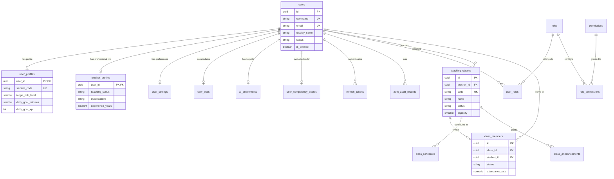
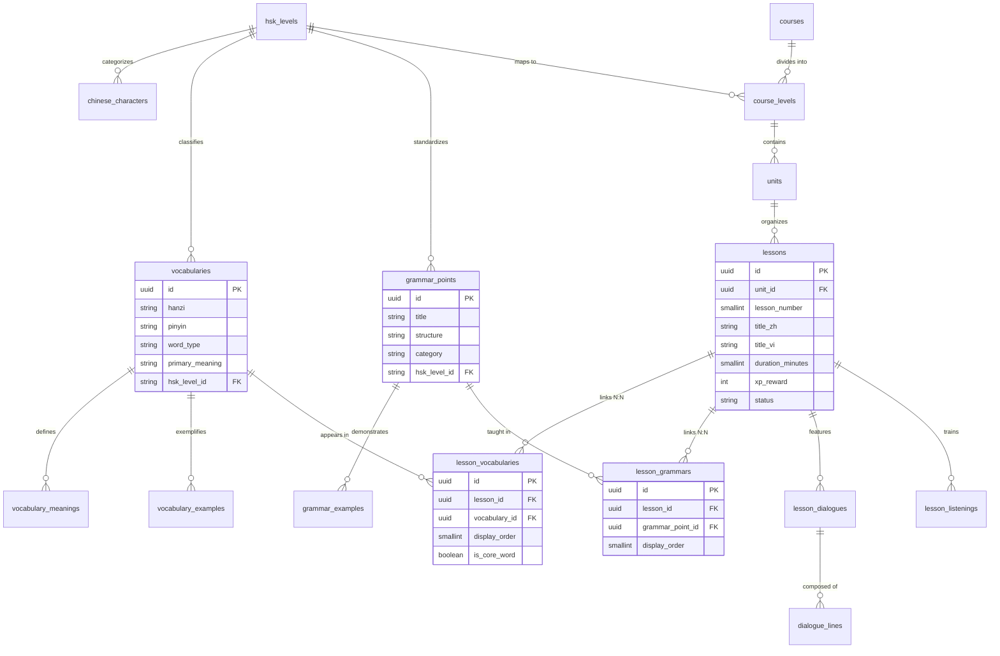
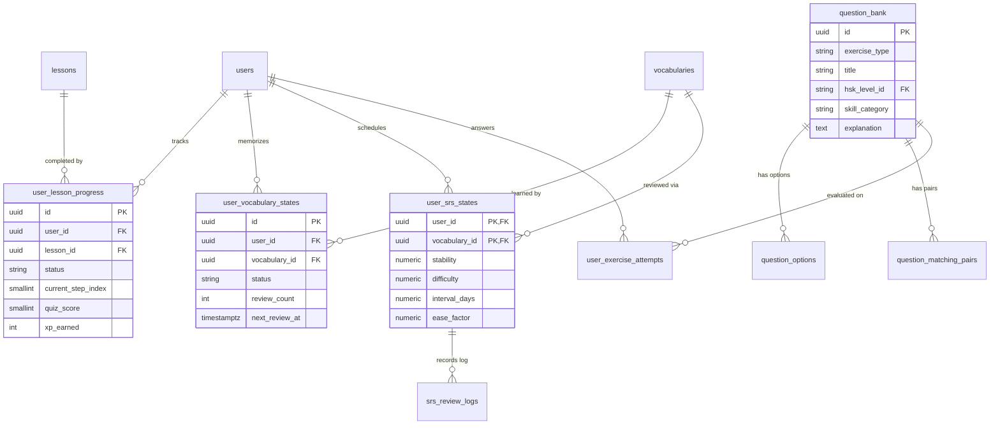
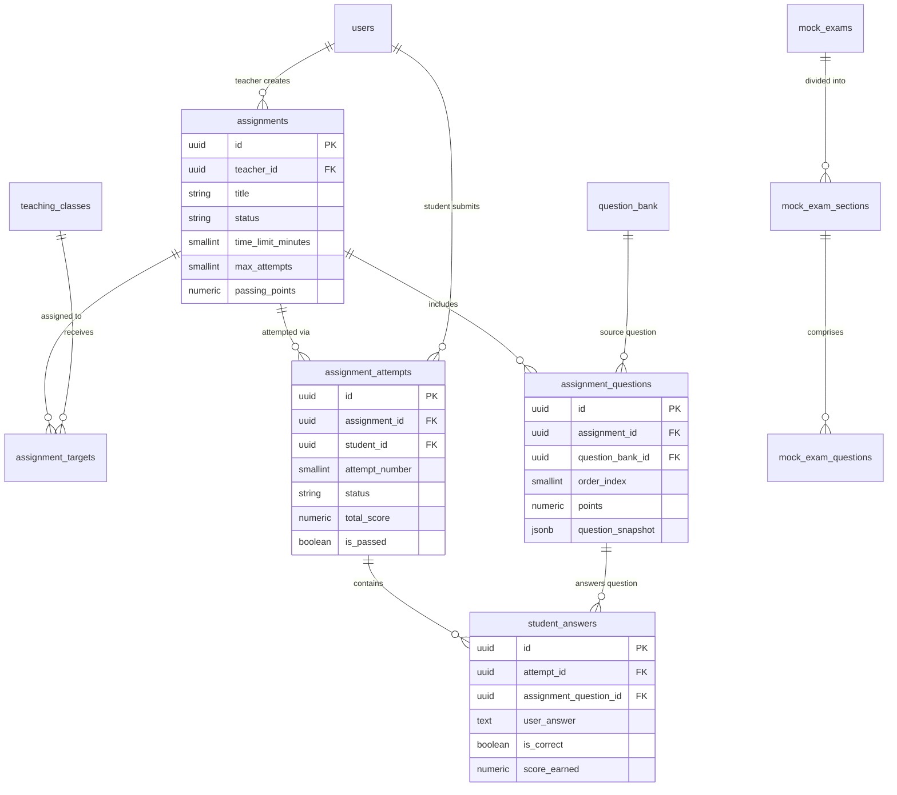
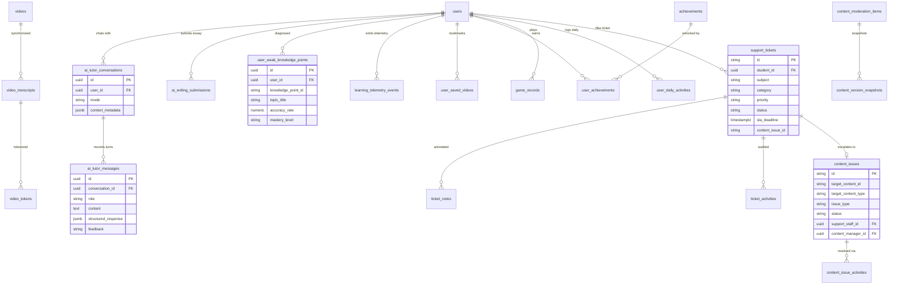

# PHÂN TÍCH MỐI QUAN HỆ & SƠ ĐỒ ERD (ZHONGWENHUB)

> **Tài liệu**: Phân tích quan hệ liên kết dữ liệu, Ràng buộc toàn vẹn & Sơ đồ Thực thể - Mối quan hệ (ERD)  
> **Người thực hiện**: Senior Database Architect & System Analyst  
> **Căn cứ**: Đề xuất CSDL tại `database-tables.md` và mã nguồn Frontend `Fontend/src`

---

## 1. PHÂN LOẠI MỐI QUAN HỆ GIỮA CÁC THỰC THỂ

### 1.1. Mối quan hệ Một - Một (One-to-One: 1:1)
Mối quan hệ 1:1 được sử dụng để tách biệt các trường dữ liệu ít dùng hoặc mang tính chuyên môn hóa, giúp giữ cho bảng lõi `users` luôn gọn gàng và truy vấn nhanh:

| Thực thể A | Thực thể B | Khóa ngoại | Mục đích & Ràng buộc |
| :--- | :--- | :--- | :--- |
| `users` | `user_profiles` | `user_profiles.user_id` -> `users.id` | Hồ sơ mở rộng của học sinh (mã HV, mục tiêu HSK, cam kết học) |
| `users` | `teacher_profiles` | `teacher_profiles.user_id` -> `users.id` | Hồ sơ chuyên môn giảng dạy dành riêng cho tài khoản giáo viên |
| `users` | `user_settings` | `user_settings.user_id` -> `users.id` | Tùy biến giao diện (hiển thị Pinyin, Giản/Phồn thể, tốc độ âm thanh) |
| `users` | `user_stats` | `user_stats.user_id` -> `users.id` | Bảng tích lũy chỉ số tổng thể (Tổng XP, chuỗi ngày Streak) |
| `users` | `ai_entitlements` | `ai_entitlements.user_id` -> `users.id` | Hạn ngạch token AI và gói dịch vụ (Free/Pro) |
| `users` | `user_competency_scores`| `user_competency_scores.user_id` -> `users.id` | Điểm radar 6 kỹ năng phục vụ AI Analytics |
| `users` + `vocabularies` | `user_srs_states` | `(user_id, vocabulary_id)` | Trạng thái thuật toán SM-2/FSRS cho từng từ vựng của từng học sinh |

### 1.2. Mối quan hệ Một - Nhiều (One-to-Many: 1:N)
Chiếm phần lớn trong các luồng dữ liệu phân cấp và lịch sử hoạt động:

| Thực thể Cha (1) | Thực thể Con (N) | Khóa ngoại | Ý nghĩa nghiệp vụ |
| :--- | :--- | :--- | :--- |
| `hsk_levels` | `chinese_characters` | `chinese_characters.hsk_level_id` | Chữ Hán thuộc cấp độ HSK chuẩn |
| `hsk_levels` | `vocabularies` | `vocabularies.hsk_level_id` | Từ vựng thuộc cấp độ HSK chuẩn |
| `hsk_levels` | `grammar_points` | `grammar_points.hsk_level_id` | Điểm ngữ pháp phân theo cấp độ HSK |
| `courses` | `course_levels` | `course_levels.course_id` | Cấp độ thuộc khóa học tổng quát |
| `course_levels` | `units` | `units.course_level_id` | Chủ đề (Unit) thuộc một cấp độ khóa học |
| `units` | `lessons` | `lessons.unit_id` | Các bài học tuần tự trong một Unit |
| `lessons` | `lesson_dialogues` | `lesson_dialogues.lesson_id` | Đoạn hội thoại ngữ cảnh của bài học |
| `lesson_dialogues` | `dialogue_lines` | `dialogue_lines.dialogue_id` | Từng câu thoại của các nhân vật |
| `lessons` | `lesson_listenings` | `lesson_listenings.lesson_id` | Phần bài tập nghe trong bài học |
| `vocabularies` | `vocabulary_meanings` | `vocabulary_meanings.vocabulary_id` | Các nét nghĩa bổ sung của từ vựng |
| `vocabularies` | `vocabulary_examples` | `vocabulary_examples.vocabulary_id` | Các câu ví dụ mẫu của từ vựng |
| `grammar_points` | `grammar_examples` | `grammar_examples.grammar_point_id` | Các câu ví dụ và trường hợp lỗi sai |
| `question_bank` | `question_options` | `question_options.question_id` | Các phương án lựa chọn A, B, C, D |
| `question_bank` | `question_matching_pairs`| `question_matching_pairs.question_id` | Các cặp thẻ nối Hanzi - Meaning |
| `mock_exams` | `mock_exam_sections` | `mock_exam_sections.exam_id` | Các phần thi (Nghe, Đọc, Viết) |
| `mock_exam_sections`| `mock_exam_questions` | `mock_exam_questions.section_id` | Các câu hỏi trong từng phần thi |
| `teaching_classes` | `class_schedules` | `class_schedules.class_id` | Lịch học các ngày trong tuần của lớp |
| `teaching_classes` | `class_announcements` | `class_announcements.class_id` | Bảng tin thông báo của lớp học |
| `assignments` | `assignment_questions` | `assignment_questions.assignment_id` | Danh sách câu hỏi trong bài tập về nhà |
| `assignments` | `assignment_targets` | `assignment_targets.assignment_id` | Phân phối bài tập đến nhiều lớp học |
| `assignment_attempts`| `student_answers` | `student_answers.attempt_id` | Chi tiết câu trả lời cho từng câu hỏi |
| `videos` | `video_transcripts` | `video_transcripts.video_id` | Từng dòng phụ đề chạy theo timeline video |
| `video_transcripts` | `video_tokens` | `video_tokens.transcript_id` | Các từ vựng được tách trong câu phụ đề |
| `ai_tutor_conversations`| `ai_tutor_messages` | `ai_tutor_messages.conversation_id` | Lịch sử các lượt chat trong phiên AI |
| `support_tickets` | `ticket_notes` | `ticket_notes.ticket_id` | Ghi chú trao đổi trên phiếu hỗ trợ |
| `support_tickets` | `ticket_activities` | `ticket_activities.ticket_id` | Lịch sử xử lý ticket |
| `content_issues` | `content_issue_activities`| `content_issue_activities.issue_id` | Lịch sử xử lý lỗi nội dung |

### 1.3. Mối quan hệ Nhiều - Nhiều (Many-to-Many: N:N) & Bảng trung gian
Hệ thống sử dụng các bảng trung gian chuẩn hóa để kết nối N:N, đi kèm các thuộc tính bổ sung (Payload) trên mối quan hệ:

| Thực thể A | Thực thể B | Bảng trung gian | Các cột bổ sung trên bảng trung gian |
| :--- | :--- | :--- | :--- |
| `users` | `roles` | `user_roles` | Gán vai trò cho người dùng |
| `roles` | `permissions` | `role_permissions` | Gán quyền hạn chi tiết cho từng vai trò |
| `lessons` | `vocabularies` | `lesson_vocabularies` | `display_order`, `is_core_word`, `custom_example_zh/vi` |
| `lessons` | `grammar_points`| `lesson_grammars` | `display_order`, `lesson_notes` |
| `teaching_classes` | `users` (Học viên) | `class_members` | `enrolled_at`, `status`, `attendance_rate`, `notes` |
| `assignments` | `teaching_classes` | `assignment_targets` | `due_date`, `close_date` |
| `users` | `vocabularies` | `user_vocabulary_states` | `status`, `review_count`, `correct_count`, `next_review_at` |
| `users` | `achievements` | `user_achievements` | `progress_percent`, `is_unlocked`, `unlocked_at` |
| `users` | `videos` | `user_saved_videos` | `saved_at` (Bookmark video) |

---

## 2. MA TRẬN RÀNG BUỘC TOÀN VẸN DỮ LIỆU & QUY TẮC XÓA (ON DELETE)

Quy tắc xử lý xóa dữ liệu liên quan được thiết kế để bảo vệ tính toàn vẹn dữ liệu tài chính, học thuật và quyền riêng tư:

```
+-----------------------------------------------------------------------------------------------------+
| LOẠI QUY TẮC   | ĐỐI TƯỢNG ÁP DỤNG                                        | Ý NGHĨA BẢO VỆ          |
+-----------------------------------------------------------------------------------------------------+
| CASCADE        | Dữ liệu phụ thuộc nội tại của một thực thể cha:           | Xóa cha thì các thành   |
|                | - `lessons` -> `lesson_vocabularies`, `lesson_grammars`   | phần con đi kèm tự động |
|                | - `lesson_dialogues` -> `dialogue_lines`                  | được dọn sạch, không để |
|                | - `teaching_classes` -> `class_schedules`, `class_members`| lại rác dữ liệu mồ côi  |
|                | - `assignments` -> `assignment_questions`, `targets`      | (orphaned records).     |
|                | - `assignment_attempts` -> `student_answers`              |                         |
|                | - `support_tickets` -> `ticket_notes`, `activities`       |                         |
|                | - `ai_tutor_conversations` -> `ai_tutor_messages`         |                         |
+-----------------------------------------------------------------------------------------------------+
| RESTRICT /     | Dữ liệu tri thức cốt lõi và giao dịch lịch sử:            | Ngăn chặn xóa nhầm dữ   |
| NO ACTION      | - `vocabularies` đang được liên kết trong `lesson_vocab`  | liệu học thuật đang có  |
|                | - `grammar_points` đang được liên kết trong `lessons`     | người học tham chiếu.   |
|                | - `question_bank` đang được bài tập phát hành sử dụng     | Muốn xóa phải gỡ liên   |
|                | - `users` (Giáo viên) đang chủ nhiệm `teaching_classes`   | kết trước.              |
+-----------------------------------------------------------------------------------------------------+
| SET NULL       | Dữ liệu kiểm toán và người thực hiện:                     | Giữ lại lịch sử thao tác|
|                | - `auth_audit_records.user_id` khi User bị xóa vĩnh viễn  | để kiểm toán an ninh dù |
|                | - `support_tickets.assignee_id` khi Staff nghỉ việc       | tài khoản nhân sự đã bị |
|                | - `content_issues.support_staff_id` khi nhân viên bị xóa  | xóa khỏi hệ thống.      |
+-----------------------------------------------------------------------------------------------------+
| SOFT DELETE    | Thực thể cốt lõi người dùng:                              | Không bao giờ xóa vật   |
| (`is_deleted`) | - `users` (`is_deleted = true`, `deleted_at`)             | lý (Hard delete) để bảo |
|                |                                                           | toàn lịch sử học tập.   |
+-----------------------------------------------------------------------------------------------------+
```

---

## 3. SƠ ĐỒ THỰC THỂ - MỐI QUAN HỆ (MERMAID ERD)

### 3.1. Phân hệ 1: Người dùng, Phân quyền & Quản lý Giáo dục



### 3.2. Phân hệ 2: Khung Chương trình HSK & Cấu trúc Bài học



### 3.3. Phân hệ 3: Tiến độ Học sinh, Thuật toán SRS & Ngân hàng Bài tập



### 3.4. Phân hệ 4: Bài tập Về nhà, Thi thử & Chấm điểm



### 3.5. Phân hệ 5: Trợ lý AI, Video, Gamification & Hỗ trợ Kiểm duyệt


